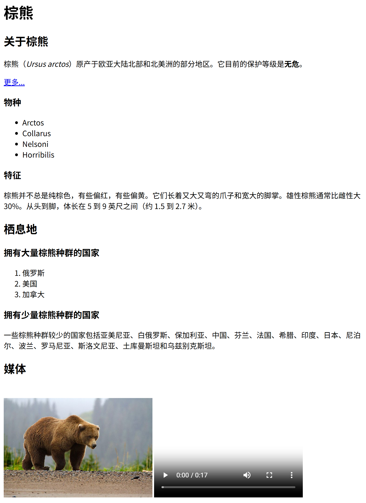

# 第4讲后项目讲义　HTML基础：把棕熊做成网页

> 课程：云应用开发　|　第2章 服务端开发基础　|　第4讲后（HTML基础，教材 3.1）

**本讲目标**：把一份纯文本 `棕熊.txt` 一步步做成网页，弄清 HTML 在做什么。本讲不改云书签。

所有命令都在 WSL 的 Ubuntu 终端里执行，网页在 Windows 的浏览器里看。遇到问题，先查文末「常见问题」。

---

## 本讲做完的样子



浏览器标签页显示「棕熊」。点「更多...」在新标签页打开百度百科。

| 段 | 做什么 | 做完时 |
|---|---|---|
| 第一段　标出结构 | 改名为 `bear.html`，给标题、段落、列表、强调加标签 | 有层级、有列表，链接和图片还是文字（检查点 结构版） |
| 第二段　接上资源 | 加链接、图片、视频 | 「更多...」能点，照片和视频显示出来（检查点 资源版） |
| 第三段　补成文档 | 补文档骨架，按意思分区 | 标签页显示「棕熊」（检查点 完成版） |
| 第四段　由服务器发出（选做） | 用 Flask 把 `bear.html` 发出去 | 页面一样，图片请求 404 |

---

## 本讲弄懂什么

本讲只弄懂一件事：**浏览器拿到一份 HTML，是怎样把它显示成一页的**。PPT 第 20 页把它画成一次显示的五步。下表的步名与那张图相同，多了两列：这一步暴露的错、在哪一段看到。

| 步 | 模块 | 做什么 | 这一步暴露的错 | 在哪一段看到 |
|---|---|---|---|---|
| ① 拿到 HTML 文本 | 四 | 读本地文件，或收到服务器的响应体 | 扩展名还是 `.txt`：当纯文本显示；服务器上找不到文件：500 | 第一段、第四段 |
| ② 读 head | 三 | 读文档类型、编码、标签页标题 | 没写 `title`：标签页显示文件名 | 第三段 |
| ③ 建元素树 | 一、三 | 按标签和嵌套建出元素树，漏写的标签替你补 | 漏写结束标签：样子错了，**不报错** | 第一段、第三段 |
| ④ 取资源 | 二 | 按 `src` 再发请求，取图片和视频 | 路径写错：裂图；服务器上没有：404 | 第二段、第四段 |
| ⑤ 画到屏幕 | — | 用浏览器的默认样式画出元素树 | 为了字大而用 `h1`：样子对了，结构错了 | 第一段 |

HTML 写错了，浏览器几乎从不报错，只会「猜着」显示。错常常犯在写标签时，到 ③、④ 才露出来。本讲的预测专门练它。

---

## 课前准备

1. 更新课程仓库：`cd ~/cloud-app-dev-2026 && git pull`
2. 列出本讲材料：`ls 第2章-服务端开发基础/第04讲后-HTML基础`
   结果：看到 `起始代码`、`检查点`、`项目讲义.md`。
3. 列出检查点：`ls 第2章-服务端开发基础/第04讲后-HTML基础/检查点`
   结果：看到 `1-结构版`、`2-资源版`、`3-完成版`。

   说明：检查点是老师准备的每段完成代码。跟丢时从这里复制，接着做下一段。
4. 建预测记录：`mkdir -p ~/work/练习 && touch ~/work/练习/第4讲后预测.md`
5. 阅读课程仓库第05讲目录里的 `HTML速查卡-页面.md`，本讲讲到的标签都在上面。

---

## 课上开工

在终端 1 执行下面的命令。终端 1 用来复制文件、打开编辑器。

```bash
mkdir -p ~/work/html-bear
cd ~/work/html-bear
cp -r ~/cloud-app-dev-2026/第2章-服务端开发基础/第04讲后-HTML基础/起始代码/* .
code .
explorer.exe .
```

结果：VS Code 打开 `html-bear` 文件夹；Windows 资源管理器也打开这个文件夹，里面有 `棕熊.txt` 和 `media`。

说明：资源管理器用来双击打开网页。改完代码要先在 VS Code 里保存（Ctrl+S），再到浏览器里刷新（F5）。

---

## 第一段　标出结构（模块一）

**目的**：把 `棕熊.txt` 改成网页，用标签标出标题、段落、列表和强调。原理见教材 3.1.1、3.1.2。

**步骤**：

1. 在 VS Code 左侧右键 `棕熊.txt`，选「重命名」，改为 `bear.html`。
2. 在资源管理器里双击 `bear.html`。
   结果：浏览器打开它，所有文字挤成一段。
3. 在 VS Code 里打开 `bear.html`，照下面的代码逐行加标签，保存：

```html
<h1>棕熊</h1>

<h2>关于棕熊</h2>
<p>棕熊（<em>Ursus arctos</em>）原产于欧亚大陆北部和北美洲的部分地区。它目前的保护等级是<strong>无危</strong>。</p>
<p>更多...
https://baike.baidu.com/item/棕熊/370530</p>

<h3>物种</h3>
<ul>
  <li>Arctos</li>
  <li>Collarus</li>
  <li>Nelsoni</li>
  <li>Horribilis</li>
</ul>

<h3>特征</h3>
<p>棕熊并不总是纯棕色，有些偏红，有些偏黄。它们长着又大又弯的爪子和宽大的脚掌。雄性棕熊通常比雌性大 30%。从头到脚，体长在 5 到 9 英尺之间（约 1.5 到 2.7 米）。</p>

<h2>栖息地</h2>
<h3>拥有大量棕熊种群的国家</h3>
<ol>
  <li>俄罗斯</li>
  <li>美国</li>
  <li>加拿大</li>
</ol>
<h3>拥有少量棕熊种群的国家</h3>
<p>一些棕熊种群较少的国家包括亚美尼亚、白俄罗斯、保加利亚、中国、芬兰、法国、希腊、印度、日本、尼泊尔、波兰、罗马尼亚、斯洛文尼亚、土库曼斯坦和乌兹别克斯坦。</p>

<h2>媒体</h2>
<p>media/brownbear.jpg
https://content.codecademy.com/courses/freelance-1/unit-1/lesson-2/htmlcss1-vid_brown-bear.mp4</p>
```

说明：文字一个字不改，只加标签。建议自己敲，不要整段粘贴：本段要练的就是哪一行该用哪个标签。「更多...」和媒体两行先包进 `p`，第二段再改。

4. 刷新浏览器。
   结果：标题分大中小三级；物种前有圆点，三国前有 1. 2. 3.；学名是斜体，「无危」是粗体。

**预测一　漏写结束标签**

- **操作**：删掉第 4 行「无危」后面的 `</strong>`，保存。
- **预测**：后面的内容会变成什么样？页面会报错吗？写进预测记录。
- **运行**：刷新浏览器。

<details>
<summary>核对（写完预测再展开）</summary>

从「无危」往后，一直到页面末尾全成了粗体；页面**不报错**。

错在写标签时漏了一个结束标签，到 ③ 建元素树时暴露：浏览器替你把 `strong` 补完，补的位置是页面最后，不是你想的「无危」后面。

</details>

- **改回**：补回 `</strong>`，保存，刷新。只有「无危」是粗体。

**检查（检查点 结构版）**：

- 「棕熊」最大，「关于棕熊」「栖息地」「媒体」次之，「物种」等再小一级。
- 物种四项带圆点，三国带 1. 2. 3.。
- 「更多...」和百科网址连成一行普通文字；「媒体」下面两行地址也是普通文字。
- 浏览器标签页显示 `bear.html`。

**跟丢了**：在终端 1 执行下面的命令，覆盖 `bear.html`。

```bash
cp ~/cloud-app-dev-2026/第2章-服务端开发基础/第04讲后-HTML基础/检查点/1-结构版/bear.html .
```

**对照与自测**（举手检查后做，没做完的课后做；教材 3.1.2）

- 第 2 步挤成一段，就是 PPT 第 5 页：连续的空格和换行合成一个空格。
- 第 4 步的层级和列表，就是 PPT 第 7 页的 h1—h6、ul、ol 加 li。
- 预测一一直粗到末尾，就是 PPT 第 8 页：漏写结束标签不报错，浏览器替你补。

<details>
<summary>自测：把「物种」的 <code>&lt;h3&gt;</code> 和 <code>&lt;/h3&gt;</code> 都改成 <code>h1</code>，页面会怎样？这样写对不对？可以动手试，试完改回。</summary>

「物种」变得和「棕熊」一样大，不报错。但结构错了：物种是「关于棕熊」下面的小节，应该是 `h3`。这类错在 ⑤ 画到屏幕时看着「没问题」，只有读结构的人（读屏软件、搜索引擎）才会被误导。

改回 `h3` 后，「物种」恢复为最小一级标题。

</details>

---

## 第二段　接上资源（模块二）

**目的**：给「更多...」加链接，把媒体下的两行地址换成图片和视频。原理见教材 3.1.2。

**步骤**：

1. 在 `bear.html` 里选中第 5、6 两行（`<p>更多...` 到 `370530</p>`）。
2. 替换为下面这一行，保存：

   ```html
   <p><a href="https://baike.baidu.com/item/棕熊/370530" target="_blank">更多...</a></p>
   ```

3. 选中最后两行（`<p>media/brownbear.jpg` 到 `.mp4</p>`）。
4. 替换为下面两行，保存：

   ```html
   
   <video src="https://content.codecademy.com/courses/freelance-1/unit-1/lesson-2/htmlcss1-vid_brown-bear.mp4" width="320" controls>你的浏览器不支持播放视频。</video>
   ```

   说明：`img` 没有结束标签。视频不在本机，`src` 写完整地址；`controls` 显示播放按钮。
5. 刷新浏览器。
   结果：「更多...」变成蓝色带下划线；「媒体」下有一张棕熊照片和一个视频播放器。
6. 点「更多...」。
   结果：新标签页打开百度百科「棕熊」词条。
7. 回到 `bear.html` 的标签页，按 F12，切到 Network（网络）面板。
8. 按 F5 刷新。
   结果：列表里至少有 `bear.html`、`brownbear.jpg` 和视频文件三行。

**观察一　图片路径写错**

- **操作**：把 `img` 的 `src` 改成 `"brownbear.jpg"`（删掉 `media/`），保存。
- **运行**：刷新浏览器，看照片的位置和 Network 面板里 `brownbear.jpg` 那一行。

<details>
<summary>核对</summary>

照片的位置只剩一个裂图图标和「一头棕熊在河滩上行走」，Network 里 `brownbear.jpg` 那一行变红（失败）。

错在写路径时少了 `media/`，到 ④ 取资源时暴露：相对路径从 `bear.html` 所在的目录找起，这里没有 `brownbear.jpg`。

</details>

- **改回**：改回 `"media/brownbear.jpg"`，保存，刷新。照片恢复。

**检查（检查点 资源版）**：

- 「更多...」能点，在新标签页打开百科。
- 照片显示；视频有播放器，能上外网时可以播放。
- 浏览器标签页仍显示 `bear.html`。

**跟丢了**：在终端 1 执行下面的命令。

```bash
cp ~/cloud-app-dev-2026/第2章-服务端开发基础/第04讲后-HTML基础/检查点/2-资源版/bear.html .
```

**对照与自测**（举手检查后做，没做完的课后做；教材 3.1.2）

- 「更多...」能点、照片能显示，就是 PPT 第 10 页的属性：`href` 说去哪，`src` 说取什么。
- 观察一的裂图，就是 PPT 第 11 页：相对路径从当前 HTML 文件所在的目录找起。
- Network 里的三行，就是 PPT 第 12 页：先取 HTML，再按 `src` 逐个取资源。

<details>
<summary>自测：在 <code>html-bear</code> 里新建文件夹 <code>pages</code>，把 <code>bear.html</code> 挪进去，照片还显示吗？<code>src</code> 该怎么改？可以动手试，试完挪回。</summary>

不显示，变成裂图：浏览器在 `pages` 里找 `media/brownbear.jpg`，没有。改成 `../media/brownbear.jpg` 就能显示（`../` 是上一级目录）。在 ④ 取资源时暴露。

试完把 `bear.html` 挪回 `html-bear`，`src` 改回 `media/brownbear.jpg`，删掉 `pages`。刷新后照片显示。

</details>

---

## 第三段　补成文档（模块三）

**目的**：补上文档骨架（`DOCTYPE`、`html`、`head`、`body`），用 `header`、`main`、`section` 按意思分区。原理见教材 3.1.1、3.1.3。

**步骤**：

1. 把 `bear.html` 的全部内容换成下面的代码，保存：

```html
<!DOCTYPE html>
<html lang="zh-CN">
  <head>
    <meta charset="UTF-8">
    <meta name="viewport" content="width=device-width, initial-scale=1.0">
    <title>棕熊</title>
  </head>
  <body>
    <header>
      <h1>棕熊</h1>
    </header>

    <main>
      <section>
        <h2>关于棕熊</h2>
        <p>棕熊（<em>Ursus arctos</em>）原产于欧亚大陆北部和北美洲的部分地区。它目前的保护等级是<strong>无危</strong>。</p>
        <p><a href="https://baike.baidu.com/item/棕熊/370530" target="_blank">更多...</a></p>

        <h3>物种</h3>
        <ul>
          <li>Arctos</li>
          <li>Collarus</li>
          <li>Nelsoni</li>
          <li>Horribilis</li>
        </ul>

        <h3>特征</h3>
        <p>棕熊并不总是纯棕色，有些偏红，有些偏黄。它们长着又大又弯的爪子和宽大的脚掌。雄性棕熊通常比雌性大 30%。从头到脚，体长在 5 到 9 英尺之间（约 1.5 到 2.7 米）。</p>
      </section>

      <section>
        <h2>栖息地</h2>
        <h3>拥有大量棕熊种群的国家</h3>
        <ol>
          <li>俄罗斯</li>
          <li>美国</li>
          <li>加拿大</li>
        </ol>
        <h3>拥有少量棕熊种群的国家</h3>
        <p>一些棕熊种群较少的国家包括亚美尼亚、白俄罗斯、保加利亚、中国、芬兰、法国、希腊、印度、日本、尼泊尔、波兰、罗马尼亚、斯洛文尼亚、土库曼斯坦和乌兹别克斯坦。</p>
      </section>

      <section>
        <h2>媒体</h2>
        
        <video src="https://content.codecademy.com/courses/freelance-1/unit-1/lesson-2/htmlcss1-vid_brown-bear.mp4" width="320" controls>你的浏览器不支持播放视频。</video>
      </section>
    </main>
  </body>
</html>
```

说明：新加的是第 1—13 行的骨架与 `header`、`main`，三个 `section`，以及末尾的结束标签；中间的内容与资源版相同，只是多缩进了几格。VS Code 里在空文件中输入 `!` 再按 Tab，能生成第 1—8 行那样的骨架（`lang` 默认是 `en`，改成 `zh-CN`）。

2. 刷新浏览器。
   结果：标签页显示「棕熊」，页面内容与第二段相同。
3. 按 F12，切到 Elements（元素）面板。
4. 点开 `<body>` 前面的三角。
   结果：`body` 下面是 `header` 和 `main`，`main` 里有三个 `section`。
5. 按 Ctrl+U，查看网页源代码。
   结果：与 VS Code 里的 `bear.html` 一字不差。

**预测二　删掉骨架标签**

- **操作**：删掉 `<html lang="zh-CN">`、`<head>`、`</head>`、`<body>`、`</body>`、`</html>` 这六行，保存。
- **预测**：两问都写进预测记录，写完再运行。
  1. 标签页标题和页面会变吗？
  2. Elements 面板里还有 `html`、`head`、`body` 吗？
- **运行**：刷新浏览器，看标签页；再看 Elements 面板。

<details>
<summary>核对（写完预测再展开）</summary>

1. 都不变：标签页仍是「棕熊」，页面一样。
2. 三层都还在，`meta`、`title` 仍在 `head` 里。浏览器在 ③ 建元素树时补上了；只有 `html` 上的 `lang="zh-CN"` 没了，因为那是你写的属性，浏览器猜不出来。

这类错哪一步都不暴露：页面看不出来，Ctrl+U 的源代码和 Elements 的树不一样才露馅。所以骨架要自己写全。

</details>

- **改回**：在 VS Code 里按 Ctrl+Z，直到六行都回来，保存，刷新。Elements 里 `html` 上又有 `lang="zh-CN"`。

**检查（检查点 完成版）**：

- 标签页显示「棕熊」。
- Elements 面板里，`body` 下是 `header` 和 `main`，`main` 里有三个 `section`。
- 页面内容与第二段相同：照片、视频、能点的「更多...」都在。

**跟丢了**：在终端 1 执行下面的命令。

```bash
cp ~/cloud-app-dev-2026/第2章-服务端开发基础/第04讲后-HTML基础/检查点/3-完成版/bear.html .
```

**对照与自测**（举手检查后做，没做完的课后做；教材 3.1.1、3.1.3）

- 标签页从 `bear.html` 变成「棕熊」，就是 PPT 第 14 页：`title` 写在 `head` 里，给浏览器看。
- 加了 `section` 页面却不变，就是 PPT 第 15 页：语义标签说清「这一块是什么」。
- 预测二里源代码和 Elements 不一样，就是 PPT 第 16 页：源代码是文本，Elements 是解析出的树。

<details>
<summary>自测：把三个 <code>section</code>（开始和结束标签）都改成 <code>div</code>，页面会变吗？Elements 里看到什么？可以动手试，试完改回。</summary>

页面不变；Elements 里 `main` 下变成三个 `div`。哪一步都不报错，看页面也看不出来：丢的是「这一块是什么」的意思，读代码的人、搜索引擎和读屏软件才分得出。

改回 `section` 后，Elements 里 `main` 下又是三个 `section`。

</details>

---

## 第四段　由服务器发出（模块四，选做）

**目的**：用第4讲的 Flask 把 `bear.html` 发出去，看看页面和请求有什么变化。原理见教材 2.4（视图函数的返回值）。

注意：云书签的服务器如果还开着，先在它的终端按 Ctrl+C 停掉。两个服务器不能同时用 5000 端口。

**步骤**：

1. 打开终端 2，执行：`cd ~/work/html-bear && source ../venv/bin/activate`
   结果：提示符前有 `(venv)`。
2. 在 VS Code 里新建 `app.py`（与 `bear.html` 同一目录），输入下面的代码，保存：

```python
from flask import Flask

app = Flask(__name__)


@app.route('/')
def bear():
    # 把写好的网页原样读出来，作为响应体返回
    with open('bear.html', encoding='utf-8') as f:
        return f.read()
```

3. 在终端 2 执行：`flask --app app run`
   结果：终端显示 `Running on http://127.0.0.1:5000`。
4. 在浏览器打开 `http://127.0.0.1:5000/`。
   结果：页面文字与完成版相同；照片的位置是裂图和 alt 文字。
5. 看终端 2 的日志。
   结果：有 `"GET / HTTP/1.1" 200` 和 `"GET /media/brownbear.jpg HTTP/1.1" 404` 两行。

**检查**：

- 地址栏是 `127.0.0.1:5000`，标签页是「棕熊」。
- 终端 2 里图片那一行是 404。

**跟丢了**：`bear.html` 照第三段「跟丢了」复制；`app.py` 照第 2 步的代码新建。做完在终端 2 按 Ctrl+C 停止服务器。

**对照与自测**（做完就做；教材 2.4）

- 页面一样、只是地址变了，就是 PPT 第 18 页：视图函数返回的字符串就是这份 HTML。
- 图片 404，就是 PPT 第 19 页的缺口二：服务器上没有这个地址，第5讲的 static 解决它。

<details>
<summary>自测：服务器开着时，把 <code>bear.html</code> 改名为 <code>index.html</code>（不改 <code>app.py</code>），刷新得到什么？在哪一步暴露？可以动手试，试完改回。</summary>

浏览器显示 500 Internal Server Error，终端 2 有 `FileNotFoundError: … 'bear.html'`。在 ① 拿到 HTML 文本时暴露：视图函数要读的文件不在了。

改回 `bear.html` 后刷新，页面恢复。最后在终端 2 按 Ctrl+C 停止服务器。

</details>

---

## 拓展（课后完成）

**规则**：

- 拓展写在新文件 `bear-ext.html` 里：先在终端 1 执行 `cp bear.html bear-ext.html`。`bear.html` 保持与检查点 完成版一致，抽查时拿来对照。
- 用到的标签查 `HTML速查卡-页面.md` 和教材 3.1.2。
- 可以用 AI。下次课开头抽查，被抽到的人做两件事中的一件：讲清拓展里的一行；当场删掉一个结束标签，先预测再刷新。

**菜单**：

| 编号 | 档 | 任务 | 何时做 | 用到哪一步 |
|---|---|---|---|---|
| E1 | 五级 | 页内目录：页头下加三个链接，点了跳到对应的一块 | 必做 | ③ |
| E2 | 五级 | 定义列表：用 `dl` 改写「特征」 | 必做 | ③、⑤ |
| E3 | 四级 | 体型表格：把「特征」里的数字做成一张表 | 选做 | ③、⑤ |

「用到哪一步」指「本讲弄懂什么」表里的五步。课后作业要写出这一列。

---

**E1　页内目录**

- **任务**：在 `header` 里 `h1` 的下面加三个链接「关于棕熊」「栖息地」「媒体」，点了页面滚到对应的 `section`。
- **提示**：给每个 `section` 加一个不重复的 `id` 属性；链接的 `href` 写成 `#` 加这个 `id`。
- **验证**：把浏览器窗口缩小到只显示半页，点「媒体」，页面滚到照片处，地址栏末尾多了 `#` 和你写的 `id`。

**E2　定义列表**

- **任务**：把「特征」那一段改成定义列表，三项：颜色、爪与掌、体型，每项一句解释。
- **提示**：`dl` 套住整个列表，`dt` 写名词，`dd` 写解释。教材 3.1.2「列表标签」有例子。
- **验证**：刷新后，解释比名词往右缩进一截；Elements 里 `dl` 下是三对 `dt`、`dd`。

**E3　体型表格**

- **任务**：在「特征」后面加一张两列的表：项目、数值。三行：体长（英尺）5—9；体长（米）约 1.5—2.7；雄性比雌性大约 30%。
- **提示**：`table` 里每行一个 `tr`，表头格用 `th`，数据格用 `td`。教材 3.1.2「表格标签」有例子。
- **验证**：刷新后看到三行两列，表头加粗；浏览器默认不画边框，看不到格线是正常的。

---

## 课后提交

在 4S 交一份文字作业，四部分，按下面的格式：

```
一、bear-ext.html 在浏览器里的截图
二、预测记录：粘贴 ~/work/练习/第4讲后预测.md（两处，想错的写了原因）
三、拓展说明：每项一行，写出用到的标签和属于哪一步，如「E1：section 的 id 与 a 的 href 对上，浏览器按 id 在元素树里找到这一块；第 ③ 步」
四、验证：每项的操作与结果
```

读教材 3.1。第5讲接着解决本讲留下的两个缺口：数据写死在页面里、图片在服务器上 404。

---

## 常见问题

| 段 | 现象 | 原因与处理 |
|---|---|---|
| 课上开工 | `explorer.exe .` 没反应 | 在资源管理器地址栏输入 `\\wsl$`，进 Ubuntu，再进 `home`、你的用户名、`work`、`html-bear` |
| 第一段 | 改名后 VS Code 里没有标签着色 | 文件名其实是 `bear.html.txt`。在 VS Code 里重命名，删掉 `.txt` |
| 第一段 | 刷新后页面没变 | 没保存：VS Code 标签上有圆点。按 Ctrl+S 再刷新 |
| 第一段 | 中文显示成乱码 | 文件没按 UTF-8 保存。点 VS Code 右下角的编码，选「通过编码保存」「UTF-8」 |
| 第二段 | 视频只有黑框，不播放 | 视频在外网服务器上，网络不通时取不到。不影响本讲 |
| 第二段 | 点「更多...」打开的地址以 `file:///` 开头 | `href` 漏写了 `https://`，被当成相对路径 |
| 第三段 | 粘贴后缩进乱了 | 不影响页面。在 VS Code 里按 Shift+Alt+F 格式化 |
| 第四段 | `Address already in use` | 5000 端口被云书签占着。在那个终端按 Ctrl+C |
| 第四段 | `flask: command not found` | 没激活虚拟环境。执行 `source ../venv/bin/activate` |
