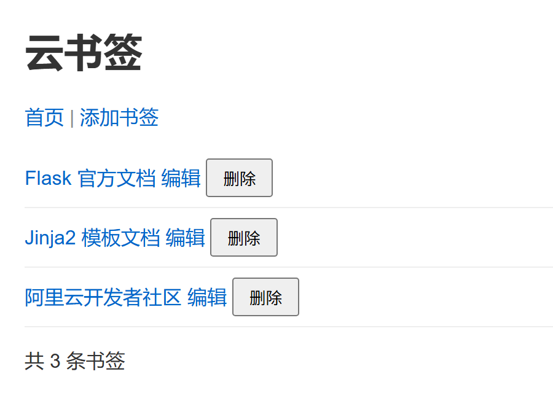

# 第5讲项目讲义　云书签 S2：列表页

> 课程：云应用开发　|　第2章 服务端开发基础　|　第5讲

**本讲目标**：在自己的云书签 S1 上，把首页的「书签列表」四个字换成一个真正的列表页。

**怎么做**：课上讲一段、做一段，共四段。页面用到的 HTML 第3章才学，本讲直接给出，你只写 `{{ }}`、`` 两种模板标记，再做一次剪切粘贴。本讲义只写操作，原理见各段标注的教材节号。

**每段的结构都一样**：

| 部分 | 作用 |
|---|---|
| 目的 | 这一段要做成什么 |
| 步骤 | 主线操作，按编号做 |
| 观察、预测 | 在做好的代码上故意改一处，先写预测再运行，看完**改回** |
| 检查 | 这一段做完时应看到什么；课上在这里举手确认 |
| 跟丢了 | 检查对不上又找不到原因时，复制老师准备好的这一段的完成代码（叫「检查点」），接着做下一段 |

所有命令都在 WSL 的 Ubuntu 终端里执行。遇到报错先查文末「常见问题」，那里按段排列。

---

## 本讲做完的样子



浏览器标签栏显示「书签列表」，点「编辑」打开 `/edit/1`。

| 段 | 做什么 | 改哪些文件 | 做完时 |
|---|---|---|---|
| 第一段　接上数据 | 复制起始模板，视图函数把数据交给模板 | `app.py` | 页面出来了，但还是写死的假数据 |
| 第二段　写出列表 | 在模板里循环输出书签 | `index.html` | 三条书签，「共 3 条书签」（检查点 S2a） |
| 第三段　拆出基础模板 | 页头和导航移到 `base.html` | 新建 `base.html`，改 `index.html` | 页面不变，标签栏是「书签列表」（检查点 S2b） |
| 第四段　链接与样式表 | 五处地址改用 `url_for`，提交 | `index.html`、`base.html` | 点「编辑」打开 `/edit/1`，已提交（检查点 S2） |

---

## 课前准备

**1. 更新课程仓库**，本讲的起始代码和检查点都在里面：

```bash
cd ~/cloud-app-dev-2026 && git pull
ls 第2章-服务端开发基础/第05讲-模板渲染与静态文件处理/起始代码    # 应看到 static、templates
ls cloud-bookmark-检查点                                         # 应看到 S2a、S2b、S2 开头的三个新目录
```

**2. 确认自己的云书签停在 S1**：

```bash
cd ~/work/cloud-bookmark
git log --oneline          # 应看到「S1: 路由骨架」，做了第4讲拓展的还有「第4讲拓展」
git status                 # 应显示 nothing to commit；有未提交的改动先提交
```

没有 S1 的，按第4讲项目讲义「跟丢了怎么办」复制 S1 检查点，提交后再来。

**3. 建好预测记录文件**。本讲有四处「先写预测再运行」，预测写在这个文件里，课后随 4S 作业提交：

```bash
mkdir -p ~/work/练习 && touch ~/work/练习/第5讲预测.md
```

---

## 课上开工

开**两个**终端。

**第一个终端**启动服务器，整节课都开着，不要关：

```bash
cd ~/work/cloud-bookmark
source ../venv/bin/activate
code .
python app.py
```

服务器开着调试模式：改 `app.py` 后自动重启，改模板后刷新浏览器即可看到变化，不用重新运行。

**第二个终端**用来复制文件、执行 `git` 命令：

```bash
cd ~/work/cloud-bookmark
```

---

## 第一段　接上数据（模块一）

**目的**：把起始模板复制进项目，用 `render_template` 把书签数据交给模板。原理见教材 2.5.1、2.5.2。

**步骤**

**1.** 在第二个终端复制起始代码：

```bash
cp -r ~/cloud-app-dev-2026/第2章-服务端开发基础/第05讲-模板渲染与静态文件处理/起始代码/* .
ls        # 应看到 app.py、docs、static、templates
```

`templates/`、`static/` 必须和 `app.py` 在同一层：Flask 默认到这两个目录里找模板和静态文件。

**2.** 改 `app.py` 三处。S1 的文件开头是一段说明文字，导入语句在它下面：

```python
from flask import Flask, render_template, request    # ① 导入语句加上 render_template

app = Flask(__name__)

# ② 预设三条书签：本讲只负责「显示」，添加功能第6讲再做；第4章改存数据库
bookmarks = [
    {'id': 1, 'title': 'Flask 官方文档', 'url': 'https://flask.palletsprojects.com/'},
    {'id': 2, 'title': 'Jinja2 模板文档', 'url': 'https://jinja.palletsprojects.com/'},
    {'id': 3, 'title': '阿里云开发者社区', 'url': 'https://developer.aliyun.com/'},
]


@app.route('/')
def index():
    return render_template('index.html', bookmarks=bookmarks)    # ③ 原来是 return '书签列表'
```

`bookmarks` 这份数据直接复制粘贴，放在 `app = Flask(__name__)` 下面。其余四条路由和第4讲的拓展都不动。

**3.** 刷新浏览器首页。

**检查**：页面有标题、导航和样式，但列表里是一条写死的「书签标题」和一行「还没有书签」，条数是空的。这是对的：数据已经交给模板，模板还没有用它，下一段解决。第一个终端里有 `GET /` 和 `GET /static/css/style.css` 两行请求（再刷新时样式表可能显示 304，表示浏览器用了缓存，也正常）。

**跟丢了**：重新执行第 1 步的复制命令，再照第 2 步改 `app.py`。

---

## 第二段　写出列表（模块二）

**目的**：在模板里用 `` 循环输出每条书签，用 `{{ }}` 输出标题和网址，用过滤器 `length` 输出条数。原理见教材 2.5.3。

**步骤**

**1.** 打开 `templates/index.html`，选中第 14 行 `<ul>` 到第 24 行 `<p>共 条书签</p>`，替换为：

```html
    <ul>
        
        <li>
            <a href="{{ bm.url }}" target="_blank">{{ bm.title }}</a>
            <a href="/edit/{{ bm.id }}">编辑</a>
            <form method="post" action="/delete/{{ bm.id }}" style="display:inline">
                <button>删除</button>
            </form>
        </li>
        
        <li>还没有书签，<a href="/add">添加第一个</a>吧！</li>
        
    </ul>
    <p>共 {{ bookmarks|length }} 条书签</p>
```

写法提示：

- `` 必须以 `` 结束，漏写会报 `TemplateSyntaxError`。
- `` 写在 for 里面，列表为空时显示。
- 编辑、删除的地址先写成 `/edit/{{ bm.id }}`，第四段再改。

**2.** 刷新首页：出现三条书签和「共 3 条书签」。

**3.** 在页面上右键「查看网页源代码」，按 Ctrl+F 搜 `{{`：搜不到，只有三个写好的 `<li>`。模板在服务器上渲染好才发出来，浏览器收到的只是 HTML。

**观察一　参数名对不上**

- **操作**：`app.py` 里把 `bookmarks=bookmarks` 改成 `items=bookmarks`，保存。
- **预测**：页面会报错，还是显示别的？条数是多少？写进预测记录。
- **运行**：刷新首页，和预测对照。

<details>
<summary>核对（写完预测再展开）</summary>

页面显示「还没有书签」「共 0 条书签」，**不报错**。模板里的变量名就是 `render_template` 的参数名；模板要的 `bookmarks` 不在上下文里，是「未定义」：输出为空、`length` 为 0、for 走 else 分支（教材 2.5.2）。

</details>

- **改回**：改回 `bookmarks=bookmarks`，刷新，三条书签恢复。

**预测一　标题是一段脚本**

- **操作**：在 `app.py` 的 `bookmarks` 列表里、`]` 的上一行，临时加第四条：`{'id': 4, 'title': "<script>alert('XSS')</script>", 'url': 'https://example.com/'},`
- **预测**：① 页面上第四条显示成什么？② 再把 `templates/index.html` 第 17 行的 `{{ bm.title }}` 改成 `{{ bm.title|safe }}`，又会怎样？两问都写完再运行。
- **运行**：先刷新首页看①，再查看网页源代码搜 `script`；然后改成 `|safe`，再刷新看②。

<details>
<summary>核对（写完预测再展开）</summary>

① 第四条把整段 `<script>…</script>` 当文字显示出来，源代码里是 `&lt;script&gt;`：`{{ }}` 输出时默认**自动转义**，浏览器只显示、不执行。② 加 `|safe` 后弹出对话框：转义被关掉，脚本被执行，这就是 XSS（跨站脚本攻击）。**`|safe` 用在用户提交的数据上就是安全漏洞**（教材 2.5.1、2.5.3）。

</details>

- **改回**：删掉第四条书签和 `|safe`，刷新，确认不再弹窗。

**检查（检查点 S2a）**：三条书签，「共 3 条书签」，没有弹窗。

**跟丢了**：在第二个终端执行

```bash
cp -r ~/cloud-app-dev-2026/cloud-bookmark-检查点/S2a-数据进入页面/templates .
```

只复制 `templates`；`app.py` 照第一段第 2 步手改，**不要整个复制**，否则第4讲的拓展会被覆盖。

---

## 第三段　拆出基础模板（模块三）

**目的**：把各页面共用的页头和导航移到基础模板 `base.html`，`index.html` 只保留列表。第6讲要加添加页、编辑页，它们直接继承 `base.html`。原理见教材 2.5.4。

开始前，`index.html` 共 29 行：第 1—13 行是页头和导航，第 14—27 行是列表，第 28—29 行是 `</body>`、`</html>`。

**步骤**

**1.** 在 `templates/` 下新建空文件 `base.html`。

**2.** 剪切 `index.html` 的第 1—13 行（`<!DOCTYPE html>` 到 `</nav>`），粘到 `base.html`。

**3.** 剪切 `index.html` 的最后两行（`</body>`、`</html>`），接着粘到 `base.html` 末尾。

**4.** 在 `base.html` 里挖两个块：`</nav>` 下面加一行 ``；`<title>` 里的「云书签」改成 `云书签`。改完的 `base.html` 应是：

```html
<!DOCTYPE html>
<html lang="zh-CN">
<head>
    <meta charset="UTF-8">
    <title>云书签</title>
    <link rel="stylesheet" href="/static/css/style.css">
</head>
<body>
    <h1>云书签</h1>
    <nav>
        <a href="/">首页</a> |
        <a href="/add">添加书签</a>
    </nav>
    
</body>
</html>
```

**5.** `index.html` 现在只剩列表一段。在最前面加三行、最后面加一行，改完应是：

```html

书签列表

    <ul>
        ……（第二段写好的列表，不动）……
    </ul>
    <p>共 {{ bookmarks|length }} 条书签</p>

```

写法提示：

- `` 写在第一行；写在它前面的字会原样出现在页面最前面。
- 子模板的内容全部放在 `` 里，块外面的内容不显示。
- 父子模板里块的名字要一致。

**6.** 刷新首页：页面和改之前**一模一样**，说明拆分正确。再查看网页源代码，`<title>` 是「书签列表」，来自子模板填的 title 块。

**观察二　块名对不上**

- **操作**：`index.html` 里把 `` 改成 ``，保存。
- **预测**：页面会报错吗？标题、导航、列表各显示吗？写进预测记录。
- **运行**：刷新首页，和预测对照。

<details>
<summary>核对（写完预测再展开）</summary>

标题和导航还在，列表消失，**不报错**。渲染时输出的是 `base.html` 的骨架，骨架里只有 `content` 块，没有 `main` 的位置，子模板填的内容无处可放（教材 2.5.4）。

</details>

- **改回**：改回 `content`，刷新，列表恢复。

**检查（检查点 S2b）**：页面和第二段结束时一样；网页源代码里的标题是「书签列表」。

**跟丢了**：

```bash
cp -r ~/cloud-app-dev-2026/cloud-bookmark-检查点/S2b-模板继承/templates .
```

---

## 第四段　链接与样式表（模块四）

**目的**：用 `url_for` 按视图函数名生成地址，让链接跟着路由走；样式表地址也用 `url_for` 生成。做完提交 S2。原理见教材 2.4.5、2.5.5。

**步骤**

**1.** 模板里写死的五处地址改用 `url_for`：

| 文件 | 原来 | 改为 |
|---|---|---|
| `index.html` 编辑链接 | `href="/edit/{{ bm.id }}"` | `href="{{ url_for('edit_bookmark', bookmark_id=bm.id) }}"` |
| `index.html` 删除按钮 | `action="/delete/{{ bm.id }}"` | `action="{{ url_for('delete_bookmark', bookmark_id=bm.id) }}"` |
| `index.html`「添加第一个」 | `href="/add"` | `href="{{ url_for('add_bookmark') }}"` |
| `base.html` 首页 | `href="/"` | `href="{{ url_for('index') }}"` |
| `base.html` 添加书签 | `href="/add"` | `href="{{ url_for('add_bookmark') }}"` |
| `base.html` 样式表 | `href="/static/css/style.css"` | `href="{{ url_for('static', filename='css/style.css') }}"` |

写法提示：

- 第一个参数是**视图函数名**，不是路径；路由里的动态部分用同名的关键字参数传入，如 `bookmark_id=bm.id`。
- 静态文件的函数名固定写 `'static'`，`filename` 是相对 `static/` 目录的路径。

**2.** 刷新首页：页面样式不变。鼠标悬停在「编辑」上，浏览器左下角显示的地址是 `/edit/1`。

**预测二　路由改名以后**

- **操作**：`app.py` 里把编辑路由的地址临时改成 `'/modify/<int:bookmark_id>'`，**函数名 `edit_bookmark` 不动**，保存。
- **预测**：① 刷新首页后，「编辑」链接的地址变成什么，点下去能打开吗？② 在浏览器地址栏直接输入 `http://127.0.0.1:5000/edit/1`，会怎样？写进预测记录。
- **运行**：刷新首页，悬停看「编辑」的地址并点击；再在地址栏输入 `/edit/1`。

<details>
<summary>核对（写完预测再展开）</summary>

① 链接变成 `/modify/1`，点开显示「编辑书签 1 的表单」：`url_for` 按函数名去路由表里反查地址，路由改了，生成的链接自动跟着变（教材 2.4.5）。② 地址栏里的 `/edit/1` 得到 404：它是写死的地址，不会跟着路由变。模板里如果还写死着 `/edit/1`，用户点下去也是这个结果。

</details>

- **改回**：编辑路由改回 `'/edit/<int:bookmark_id>'`，刷新，悬停看地址变回 `/edit/1`。第6讲要接着写编辑功能，**一定要改回**。

**3.** 自查 `app.py` 已改回：

```bash
grep -n "modify" app.py      # 应没有任何输出；有输出说明路由没改回
git diff app.py              # 只应看到第一段的三处改动：导入、预设数据、index 返回模板
```

**4.** 提交：

```bash
git add .
git commit -m "S2: 列表页"
```

**检查（检查点 S2）**：点「编辑」打开 `/edit/1`；`git log --oneline` 看得到「S2: 列表页」。项目结构应是：

```
cloud-bookmark/
├── app.py                 index 用 render_template，其余四条路由不变
├── templates/
│   ├── base.html          页头、导航，挖 title、content 两个块
│   └── index.html         继承 base.html，for-else 输出书签
├── static/css/style.css
├── docs/接口表.md
├── requirements.txt
└── .gitignore
```

**跟丢了**：复制检查点的模板，再做第 3、4 步：

```bash
cp -r ~/cloud-app-dev-2026/cloud-bookmark-检查点/S2-列表页/templates .
```

**本讲记住一条**：项目里的链接、表单地址和静态文件地址，一律用 `url_for` 生成，不手写路径。

---

## 拓展（课后完成）

**规则**：

- 拓展的路由写在 `app.py`「拓展写在这里」那一行与 `if __name__` 之间；新页面用**新的模板文件**，继承 `base.html`。
- **不改主线**：五条路由、`index.html`、`base.html` 都不动。下一讲接着改主线，拓展放在单独的文件里，才不会互相影响。
- 可以用 AI，但要能讲清每一行。下一讲开头抽查时会请你讲一行、改一处、预测一个结果。
- 每项做完，打开首页确认主线没被改坏：三条书签、「共 3 条书签」、编辑链接是 `/edit/1`。

**E1、E2 必做；E3—E5 任选一项。**

### E1　关于页（五级）

- **任务**：`/about` 改为页面：新建 `templates/about.html`，继承 `base.html`，填 `title`、`content` 两个块。第4讲没有做 `/about` 的，新建这条路由。
- **验证**：浏览器打开 `http://127.0.0.1:5000/about`，有「云书签」标题和导航；网页源代码里 `<title>` 是你填的标题。

### E2　条数页（五级）

- **任务**：`/count`：新页面显示「共 N 条书签」；用 `` 判断，超过 2 条显示「书签不少了」，否则显示「再加几条吧」。
- **提示**：`…………`，与 for 一样以结束标记收尾。条数可以在视图函数里用 `len(bookmarks)` 算好再传进模板，也可以在模板里用 `|length`。
- **验证**：打开 `/count`，看到「共 3 条书签」和「书签不少了」；在 `bookmarks` 里临时注释掉两条，刷新应看到「再加几条吧」，看完恢复。

### E3　详情页（四级）

- **任务**：`/bookmark/<int:bookmark_id>`：显示一条书签的标题、网址和一个回首页的链接（用 `url_for`）；编号不存在时返回 404。
- **提示**：在视图函数里用 for 循环找 `id` 等于 `bookmark_id` 的那条书签，找到就 `render_template`；循环结束还没找到，返回 `'书签不存在', 404`（第4讲学过：返回元组，第二项是状态码）。
- **验证**：`curl -i http://127.0.0.1:5000/bookmark/1` 得到 200 并含「Flask 官方文档」；`/bookmark/9`、`/bookmark/abc` 都得到 404。

### E4　编号列表（四级）

- **任务**：`/numbered`：用循环变量 `loop.index` 给书签编号，再挑一个过滤器用在标题上。
- **提示**：`loop.index` 只能在 `` 里面用，从 1 开始计数。中文标题加 `upper` 看不出变化，用「Flask 官方文档」验证。
- **验证**：打开 `/numbered`，每条前面有 1、2、3 编号，标题经过你选的过滤器处理。

### E5　自选页面（四级）

- **任务**：自己设计一个继承 `base.html` 的新页面，`for`、`if` 至少用一个，过滤器至少一个，`url_for` 至少一处。
- **验证**：自己写两步：打开哪个地址、应看到什么。

---

## 课后提交

1. 拓展做完后提交：`git add . && git commit -m "第5讲拓展"`。
2. 在 4S 交一份文字作业，四部分，按下面的格式：

   ```
   一、git log --oneline -3 的输出
   二、预测记录：粘贴 ~/work/练习/第5讲预测.md（四处，想错的写了原因）
   三、拓展说明：每项一行，「E2：用  按条数选择显示的文字，模板里的判断要用 endif 结束」这样写
   四、验证：每项的操作与结果（截图或 curl 输出）
   ```
3. 读教材 2.6：下一讲把「添加书签的表单」这几个字换成真正的表单。

---

## 常见问题

遇到报错或结果与预期不符时，按出现的段查找。

| 段 | 现象 | 原因 | 处理 |
|---|---|---|---|
| 开工 | `Address already in use` 或 `Port 5000 is in use` | 另一个终端里已经在运行 `python app.py` | 回到那个终端按 Ctrl+C 停掉，或直接用它；同一时间只运行一个 |
| 开工 | `No module named 'flask'` | 虚拟环境未激活 | 在 `~/work/cloud-bookmark` 下执行 `source ../venv/bin/activate`，提示符前应出现 `(venv)` |
| 一 | `jinja2.exceptions.TemplateNotFound: index.html` | `templates` 目录不在 `app.py` 同一层，或目录名、文件名拼错（如 `template`） | `ls ~/work/cloud-bookmark` 应同时看到 `app.py` 和 `templates`；不对就重新执行第一段第 1 步 |
| 一 | 页面没有样式，终端里有 `GET /static/css/style.css` 的 404 | `static` 目录没复制，或不在 `app.py` 同一层 | 重新执行第一段第 1 步 |
| 一 | 页面上原样显示 `{{ bm.title }}` | 在文件管理器里双击打开了 HTML 文件，没有经过 Flask | 用浏览器访问 `http://127.0.0.1:5000` |
| 二 | 页面显示「还没有书签」「共 0 条书签」 | `render_template` 的参数名和模板里的变量名对不上 | 改成 `render_template('index.html', bookmarks=bookmarks)` |
| 二 | `TemplateSyntaxError: Unexpected end of template. Jinja was looking for the following tags: 'endfor' or 'else'` | 少写了 `` | 在列表末尾补上。提示里列的是 `'endif'`、`'endblock'` 的，同理补 ``、`` |
| 二 | 每次刷新都弹窗 | 预测一的第四条书签或 `\|safe` 没删 | 两处都删掉 |
| 三 | 只剩标题和导航，列表不见了 | 子模板的块名和 `base.html` 里的不一致 | 两边都写 `content` |
| 三 | 子模板里新加的内容没显示 | 写在了 `` 外面 | 子模板的内容全部放进块里 |
| 三 | 页面最上面多出一些文字 | 写在了 `` 前面，那几个字原样输出 | `` 放在第一行 |
| 四 | `BuildError: Could not build url for endpoint 'edit'. Did you mean 'edit_bookmark' instead?` | `url_for` 的第一个参数写成了路径或别的名字 | 写视图函数名：`'edit_bookmark'` |
| 四 | `BuildError: ... Did you forget to specify values ['bookmark_id']?` | 动态路由的参数没有传 | `url_for('edit_bookmark', bookmark_id=bm.id)` |
| 四 | 点「编辑」得到 404 | 预测二临时改的路由地址忘了改回来 | 改回 `/edit/<int:bookmark_id>`；`grep -n modify app.py` 应无输出 |
| 跟丢了 | 复制检查点后第4讲的拓展没了 | 整个复制了 `app.py` | `git diff app.py` 能看到被删掉的拓展，复制回去；或 `git checkout app.py` 恢复到上次提交，再照第一段手改三处 |
| 提交 | `git status` 里看到 `__pycache__` | `.gitignore` 缺失 | 执行 `printf 'venv/\n__pycache__/\n.env\n' > .gitignore` 后再提交 |

---

## 附：云书签的阶段

| 阶段 | 哪一讲 | 做什么 |
|---|---|---|
| S0 | 第3讲 | 接口表 |
| S1 | 第4讲 | 五条路由，返回占位文字 |
| **S2** | **第5讲（本讲）** | **首页换成模板页面** |
| S3 | 第6讲 | 添加书签：表单提交、验证、保存 |
| S4 | 第7讲 | 删除与测试，第2章完成版 |
