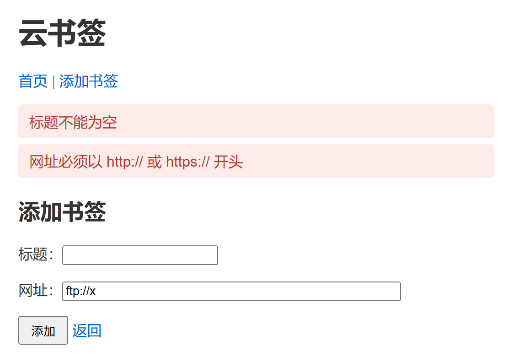
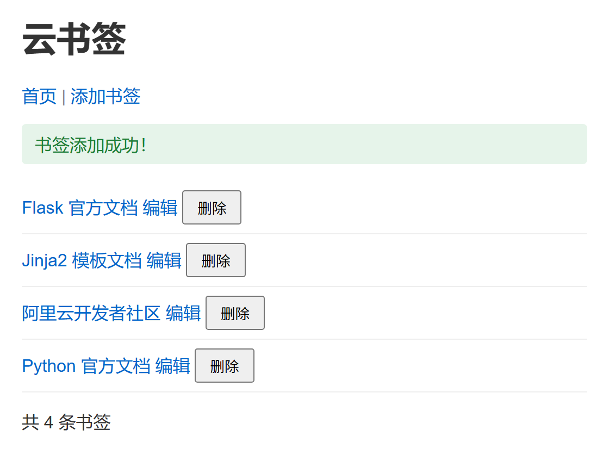

# 第6讲项目讲义　云书签 S3：添加书签

> 课程：云应用开发　|　第2章 服务端开发基础　|　第6讲

**本讲目标**：在自己的云书签 S2 上，让「添加书签」真正能用：填表、提交、存进列表；成功回到首页并提示，填错了留在表单上报错。

所有命令都在 WSL 的 Ubuntu 终端里执行。遇到报错，先查文末「常见问题」。

---

## 本讲做完的样子

提交失败（左）与提交成功（右）：





标题填三个空格、网址填 `ftp://x`：留在 `/add`，两条红色提示，网址框里还是 `ftp://x`。填对了：地址回到 `/`，绿色「书签添加成功！」，再刷新提示消失。

| 段 | 做什么 | 改哪些文件 | 做完时 |
|---|---|---|---|
| 第一段　接收表单、存进列表 | 复制添加表单，视图函数按 name 取值、存进列表 | `app.py` | 添加后首页多一条（检查点 S3a） |
| 第二段　重定向与提示 | 成功后 flash 提示、重定向回首页 | `app.py`、`base.html` | 地址回到 `/`，绿色提示，F5 不重复（检查点 S3b） |
| 第三段　验证与回填 | 服务端验证，失败留在表单并回填，提交 | 新建 `validators.py`，改 `app.py`、`add.html` | 填错留在表单报错，网址回填，已提交（检查点 S3） |

---

## 本讲弄懂什么

本讲只弄懂一件事：**用户在表单里填的数据，怎样可靠地存进服务器的列表**。PPT 第 17 页把它画成一次添加书签的七步。下表的步名与那张图相同，多了两列：这一步暴露的错、在哪一段看到。

| 步 | 模块 | 做什么 | 这一步暴露的错 | 在哪一段看到 |
|---|---|---|---|---|
| ① GET /add | 一 | 显示添加表单 | `add.html` 不在 `templates/`：500 | 第一段 |
| ② 浏览器 | 三 | 提交前先查 `required`、`type="url"` | 空标题被拦下，请求不发出；curl 不经过这一步 | 第三段 |
| ③ POST /add | 一 | 请求体里每个字段写成 name=值 | 缺字段、name 写错：请求照发，**不报错** | 第一段 |
| ④ 取值 | 一 | `form.get` 取值，再 `strip` | 取不到时得空串，**不报错** | 第一段 |
| ⑤ 验证 | 三 | `validate_bookmark` 返回错误列表 | 不合格：红色提示，留在表单并回填 | 第三段 |
| ⑥ 保存 | 二 | 存进列表，`flash`，返回 302 | 没有 302：按 F5 重复提交 | 第二段 |
| ⑦ GET / | 二 | 首页取出提示，显示一次 | 页面没有消息显示区：提示不出现，**不报错** | 第二段 |

注意 ③、④ 这类不报错的错：错犯在前面（如 ③ 少发了标题），一路没人拦，直到首页列表里出现一条没有标题的书签才暴露。第三段加的 ⑤ 验证，就是把这类错拦在保存之前，变成看得见的提示。

---

## 课前准备

1. 更新课程仓库：`cd ~/cloud-app-dev-2026 && git pull`
2. 列出起始代码：`ls 第2章-服务端开发基础/第06讲-表单处理与用户输入/起始代码/templates`
   结果：看到 `add.html`。
3. 列出检查点：`ls cloud-bookmark-检查点`
   结果：看到 `S3a`、`S3b`、`S3` 开头的三个新目录。

   说明：检查点是老师准备的每段完成代码。跟丢时从这里复制，接着做下一段。
4. 进入云书签：`cd ~/work/cloud-bookmark`
5. 查看提交记录：`git log --oneline`
   结果：看到「S2: 列表页」。做了第5讲拓展的，还有「第5讲拓展」。
6. 查看工作区：`git status`
   结果：显示 `nothing to commit`。
7. 建预测记录：`mkdir -p ~/work/练习 && touch ~/work/练习/第6讲预测.md`
8. 阅读课程仓库里本讲的 `HTML速查卡-表单.md`，对照起始代码的 `templates/add.html`。

如果第 5 步没有「S2: 列表页」，执行下面的命令，再照第5讲项目讲义第一段第 3、4 步改 `app.py`，然后提交：

```bash
cp -r ~/cloud-app-dev-2026/cloud-bookmark-检查点/S2-列表页/templates ~/work/cloud-bookmark/
```

如果第 6 步有未提交的改动，先提交。

---

## 课上开工

在终端 1 执行下面的命令。终端 1 运行服务器，整节课不关。

```bash
cd ~/work/cloud-bookmark
source ../venv/bin/activate
code .
python app.py
```

打开终端 2，执行下面的命令。终端 2 用来执行 `cp`、`curl`、`git`。

```bash
cd ~/work/cloud-bookmark
source ../venv/bin/activate
```

结果：两个终端的提示符前都有 `(venv)`。

说明：书签存在内存里。服务器每重启一次，列表就恢复成预设的三条；保存 `app.py` 后的自动重启也算（第4章改存数据库）。

---

## 第一段　接收表单、存进列表（模块一）

**目的**：打开 `/add` 显示添加表单；提交后，视图函数按表单的 name 取出标题和网址，存进书签列表。原理见教材 2.6.1、2.6.2。

**步骤**：

1. 在终端 2 复制起始代码：

   ```bash
   cp -r ~/cloud-app-dev-2026/第2章-服务端开发基础/第06讲-表单处理与用户输入/起始代码/* .
   ```

2. 列出模板：`ls templates`
   结果：看到 `add.html`、`base.html`、`index.html`。
3. 打开 `templates/add.html`，找到两个输入框的 `name`。
   结果：`name="title"`、`name="url"`；`<form>` 上是 `method="post"`。

   说明：表单的 HTML 本讲直接给出，各标签的含义见 `HTML速查卡-表单.md`。下面取值就按这两个名字。
4. 打开 `app.py`，选中从 `from flask import` 到 `return '添加书签的表单'` 的几行。
5. 替换为下面的代码，保存：

```python
from flask import Flask, render_template, request

app = Flask(__name__)

# 预设三条书签：第4章改存数据库
bookmarks = [
    {'id': 1, 'title': 'Flask 官方文档', 'url': 'https://flask.palletsprojects.com/'},
    {'id': 2, 'title': 'Jinja2 模板文档', 'url': 'https://jinja.palletsprojects.com/'},
    {'id': 3, 'title': '阿里云开发者社区', 'url': 'https://developer.aliyun.com/'},
]
next_id = 4   # 新书签的编号接着预设的三条往下排


# 接口表「查看列表」：视图函数只准备数据，页面长什么样由模板决定
@app.route('/')
def index():
    return render_template('index.html', bookmarks=bookmarks)


# 接口表「打开添加表单」「提交新书签」：同一个地址，GET 显示，POST 处理
@app.route('/add', methods=['GET', 'POST'])
def add_bookmark():
    global next_id                     # 要改的是函数外面的 next_id
    if request.method == 'POST':
        # 按表单的 name 取值；.get 给默认值，字段缺失也不出错；strip 去掉首尾空格
        title = request.form.get('title', '').strip()
        url = request.form.get('url', '').strip()
        bookmarks.append({'id': next_id, 'title': title, 'url': url})
        next_id += 1
        return render_template('index.html', bookmarks=bookmarks)
    return render_template('add.html')
```

说明：改了两处：加了 `next_id = 4`；`add_bookmark` 的 POST 分支取值、存进列表、渲染首页，GET 分支返回添加表单。`.get` 的键名必须与 `name` 一字不差。函数里要给外面的 `next_id` 重新赋值，所以先写 `global next_id`。其余三条路由和前几讲的拓展都不动。

6. 在浏览器点导航的「添加书签」。
   结果：地址是 `/add`，页面上有标题、网址两个输入框。
7. 标题填「Python 官方文档」、网址填 `https://docs.python.org/`，点「添加」。
   结果：列表出现第 4 条「Python 官方文档」。地址栏仍是 `/add`。

**预测一　只发网址，不发标题**

注意：现在地址栏是 `/add`，不要按 F5。F5 会把刚才的表单再提交一次。

- **预测**：在终端 2 执行 `curl -d "url=https://only.url/" http://127.0.0.1:5000/add`。服务器会报错，还是存下一条书签？标题是什么？写进预测记录。
- **运行**：执行 curl（输出是一大段首页 HTML，先不看）。再在浏览器点导航的「首页」。

<details>
<summary>核对（写完预测再展开）</summary>

不报错，存下了第 5 条书签，标题是空的：列表里那一行只有「编辑」「删除」。

错在 ③ 请求里缺了 `title`；④ 取值时 `.get('title', '')` 给了空串，程序照常往下走。现在没有验证，一路没人拦，到首页列表才暴露。第三段解决。

</details>

**检查（检查点 S3a）**：首页 5 条：第 4 条「Python 官方文档」，第 5 条没有标题。

**跟丢了**：在终端 2 执行下面的命令，再照第 4、5 步改 `app.py`。

注意：不要整个复制 `app.py`，否则前几讲的拓展会被覆盖。

```bash
cp -r ~/cloud-app-dev-2026/cloud-bookmark-检查点/S3a-接收表单/templates .
```

**对照与自测**（举手检查后做，没做完的课后做；教材 2.6.1、2.6.2）

- 第 3 步的 `name="title"` 和第 5 步的 `.get('title', '')`，就是 PPT 第 5 页的「name 连接表单与视图函数」。
- 预测一存下空标题，就是 PPT 第 8 页的 `.get` 给默认值：缺字段得空串，不报错。
- 第 7 步地址栏停在 `/add`，就是 PPT 第 10 页上排：POST 后直接返回页面。第二段改它。

<details>
<summary>自测：把第 5 步的 <code>request.form.get('title', '')</code> 写成 <code>request.args.get('title', '')</code>，从浏览器添加一条，结果是什么？在哪一步暴露？可以动手试，试完改回。</summary>

不报错。列表多一条书签，网址正常，标题是空的。

错在 ④ 取值时找错了位置：`args` 是地址里 `?` 后面的查询字符串，POST 表单的数据在请求体里，要用 `form`（PPT 第 7 页）。和预测一一样，到首页列表才暴露。

改回 `request.form.get('title', '')`，保存。服务器自动重启，列表恢复三条。

</details>

---

## 第二段　重定向与提示（模块二）

**目的**：添加成功后，先存一条提示，再重定向回首页。浏览器停在 `GET /`，按 F5 不会重复提交；提示在首页显示一次就消失。原理见教材 2.6.4。

**步骤**：

1. 打开 `app.py`，选中从 `from flask import` 到 `add_bookmark` 最后一行 `return render_template('add.html')` 的几行。
2. 替换为下面的代码，保存：

```python
from flask import Flask, render_template, request, redirect, url_for, flash

app = Flask(__name__)
app.secret_key = 'dev-secret-key'   # flash 存在会话里，会话要用密钥签名；第7讲改为从环境变量读取

# 预设三条书签：第4章改存数据库
bookmarks = [
    {'id': 1, 'title': 'Flask 官方文档', 'url': 'https://flask.palletsprojects.com/'},
    {'id': 2, 'title': 'Jinja2 模板文档', 'url': 'https://jinja.palletsprojects.com/'},
    {'id': 3, 'title': '阿里云开发者社区', 'url': 'https://developer.aliyun.com/'},
]
next_id = 4   # 新书签的编号接着预设的三条往下排


# 接口表「查看列表」：视图函数只准备数据，页面长什么样由模板决定
@app.route('/')
def index():
    return render_template('index.html', bookmarks=bookmarks)


# 接口表「打开添加表单」「提交新书签」：同一个地址，GET 显示，POST 处理
@app.route('/add', methods=['GET', 'POST'])
def add_bookmark():
    global next_id                     # 要改的是函数外面的 next_id
    if request.method == 'POST':
        # 按表单的 name 取值；.get 给默认值，字段缺失也不出错；strip 去掉首尾空格
        title = request.form.get('title', '').strip()
        url = request.form.get('url', '').strip()
        bookmarks.append({'id': next_id, 'title': title, 'url': url})
        next_id += 1
        flash('书签添加成功！', 'success')
        return redirect(url_for('index'))   # PRG：浏览器接着 GET /，刷新只重发这个 GET
    return render_template('add.html')
```

说明：改了三处：导入加上 `redirect`、`url_for`、`flash`；加了 `app.secret_key`；`next_id += 1` 下面的 `return` 换成 `flash` 和 `redirect` 两行。

3. 把 `templates/base.html` 的全部内容换成下面的代码，保存：

   ```html
   <!DOCTYPE html>
   <html lang="zh-CN">
   <head>
       <meta charset="UTF-8">
       <title>云书签</title>
       <link rel="stylesheet" href="{{ url_for('static', filename='css/style.css') }}">
   </head>
   <body>
       <h1>云书签</h1>
       <nav>
           <a href="{{ url_for('index') }}">首页</a> |
           <a href="{{ url_for('add_bookmark') }}">添加书签</a>
       </nav>
       
       <p class="flash flash-{{ category }}">{{ msg }}</p>
       
       
   </body>
   </html>
   ```

   说明：`</nav>` 下面的三行是本步加的消息显示区。写在 `base.html` 里，所有页面都有。
4. 在浏览器打开 `/add`，添加「Python 官方文档」`https://docs.python.org/`。
   结果：地址栏是 `/`，顶部绿色「书签添加成功！」，共 4 条。
5. 看终端 1 最后几行。
   结果：先是 `POST /add` 302，接着是 `GET /` 200。
6. 按 F5。
   结果：不弹对话框，提示消失，仍是 4 条。

**预测二　改回直接渲染，再按 F5**

- **操作**：把第 2 步的 `return redirect(url_for('index'))` 临时改成 `return render_template('index.html', bookmarks=bookmarks)`，保存。
- **预测**：添加一条书签后按 F5，浏览器会怎样？列表会怎样？写进预测记录。
- **运行**：添加一条书签，按 F5，在弹出的对话框里点「继续」。

<details>
<summary>核对（写完预测再展开）</summary>

浏览器弹出「确认重新提交表单」，点「继续」后列表又多一条。

刷新会重发最后一次请求，这里最后一次是 `POST /add`。错在 ⑥ 保存后没有返回 302，到刷新时才暴露。改成重定向后，最后一次请求是 `GET /`，刷新只是重新查看。

</details>

- **改回**：改回 `return redirect(url_for('index'))`，保存。服务器自动重启，列表恢复三条。

**检查（检查点 S3b）**：添加一条后，地址栏是 `/`，顶部绿色「书签添加成功！」；按 F5，提示消失，条数不变。

**跟丢了**：在终端 2 执行下面的命令，再照第 1、2 步改 `app.py`（第 2 步的代码已含第一段的改动）。

```bash
cp -r ~/cloud-app-dev-2026/cloud-bookmark-检查点/S3b-重定向与提示/templates .
```

**对照与自测**（举手检查后做，没做完的课后做；教材 2.6.4）

- 第 5 步的 302 接 `GET /`、第 6 步 F5 不重复，就是 PPT 第 10 页下排的 PRG。
- 第 6 步提示消失，就是 PPT 第 11 页的 flash：存进会话，取出一次就删。
- 第 2 步的 `app.secret_key`，就是 PPT 第 12 页：会话靠它签名。

<details>
<summary>自测：把第 2 步的 <code>redirect(url_for('index'))</code> 改成 <code>redirect(url_for('add_bookmark'))</code>，添加一条，会看到什么？提示出现在哪一页？可以动手试，试完改回。</summary>

地址栏变成 `/add`，空白的添加表单上方显示绿色「书签添加成功！」。按 F5 也不弹对话框。

302 之后浏览器发的是 `GET /add`，⑦ 由这一次请求的页面取出提示。消息显示区在 `base.html` 里，哪一页都能显示。

改回 `redirect(url_for('index'))`，保存。服务器自动重启，列表恢复三条。

</details>

---

## 第三段　验证与回填（模块三）

**目的**：在服务器上验证标题和网址。不合格就报错、不保存，留在表单上，并把已填的内容放回输入框；合格才保存、提示、重定向。做完提交 S3。原理见教材 2.6.3。

**步骤**：

1. 在 VS Code 里新建文件 `validators.py`，与 `app.py` 放在同一层。
2. 把下面的代码复制进 `validators.py`，保存：

```python
"""
云书签的验证规则（第6讲　第三段）

服务端验证是数据进入系统前的最后一道防线。验证写成独立的函数：
逐条检查，返回错误列表（空列表表示通过），一次报全，用户一次改完。
净化（strip）在视图函数取值时做，这里只检查。
规则与教材配套代码 v2 一致；提示里的「URL」改称「网址」，与添加页上的字一致。
"""

MAX_TITLE_LENGTH = 100
MAX_URL_LENGTH = 500


def validate_bookmark(title, url):
    """验证书签数据，返回错误消息列表"""
    errors = []
    if not title:
        errors.append('标题不能为空')
    elif len(title) > MAX_TITLE_LENGTH:
        errors.append(f'标题不能超过{MAX_TITLE_LENGTH}个字符')
    if not url:
        errors.append('网址不能为空')
    elif not url.startswith(('http://', 'https://')):
        errors.append('网址必须以 http:// 或 https:// 开头')
    elif len(url) > MAX_URL_LENGTH:
        errors.append(f'网址不能超过{MAX_URL_LENGTH}个字符')
    return errors
```

3. 打开 `app.py`，选中从 `from flask import` 到 `add_bookmark` 最后一行 `return render_template('add.html')` 的几行。
4. 替换为下面的代码，保存：

```python
from flask import Flask, render_template, request, redirect, url_for, flash
from validators import validate_bookmark

app = Flask(__name__)
app.secret_key = 'dev-secret-key'   # flash 存在会话里，会话要用密钥签名；第7讲改为从环境变量读取

# 预设三条书签：第4章改存数据库
bookmarks = [
    {'id': 1, 'title': 'Flask 官方文档', 'url': 'https://flask.palletsprojects.com/'},
    {'id': 2, 'title': 'Jinja2 模板文档', 'url': 'https://jinja.palletsprojects.com/'},
    {'id': 3, 'title': '阿里云开发者社区', 'url': 'https://developer.aliyun.com/'},
]
next_id = 4   # 新书签的编号接着预设的三条往下排


# 接口表「查看列表」：视图函数只准备数据，页面长什么样由模板决定
@app.route('/')
def index():
    return render_template('index.html', bookmarks=bookmarks)


# 接口表「打开添加表单」「提交新书签」：同一个地址，GET 显示，POST 处理
@app.route('/add', methods=['GET', 'POST'])
def add_bookmark():
    global next_id                     # 要改的是函数外面的 next_id
    if request.method == 'POST':
        # 按表单的 name 取值；.get 给默认值，字段缺失也不出错；strip 去掉首尾空格
        title = request.form.get('title', '').strip()
        url = request.form.get('url', '').strip()

        errors = validate_bookmark(title, url)
        if errors:                                       # 失败：报错，留在表单上，回填已填内容
            for e in errors:
                flash(e, 'error')
            return render_template('add.html', title=title, url=url)

        bookmarks.append({'id': next_id, 'title': title, 'url': url})
        next_id += 1
        flash('书签添加成功！', 'success')
        return redirect(url_for('index'))   # PRG：浏览器接着 GET /，刷新只重发这个 GET
    return render_template('add.html')
```

说明：改了两处：第 2 行导入 `validate_bookmark`；取值之后、保存之前加了验证的 5 行。POST 分支的顺序是：取值、验证（失败就返回表单）、保存、提示、重定向。

5. 把 `templates/add.html` 的全部内容换成下面的代码，保存：

   ```html
   
   添加书签
   
   <h2>添加书签</h2>
   <form action="{{ url_for('add_bookmark') }}" method="post">
       <p>标题：<input type="text" name="title" value="{{ title }}" required maxlength="100"></p>
       <p>网址：<input type="url" name="url" value="{{ url }}" required maxlength="500" size="50" placeholder="https://"></p>
       <p><button type="submit">添加</button> <a href="{{ url_for('index') }}">返回</a></p>
   </form>
   
   ```

   说明：第 6、7 行各加了一个 `value`，用来回填。直接打开 `/add` 时没有传 `title`、`url`，它们是「未定义」，输出为空（第5讲），所以输入框是空的。
6. 在浏览器打开 `/add`，标题填三个空格、网址填 `ftp://x`，点「添加」。
   结果：留在 `/add`，两条红色提示，标题框是空的，网址框里还是 `ftp://x`。
7. 标题框保持为空，直接点「添加」。
   结果：浏览器提示「请填写此字段」，终端 1 没有新的 `POST /add`。
8. 标题填「Python 官方文档」、网址填 `https://docs.python.org/`，点「添加」。
   结果：回到首页，绿色「书签添加成功！」，共 4 条。

**预测三　绕过浏览器提交空标题**

- **预测**：第 7 步浏览器拦下了空标题。在终端 2 执行 `curl -d "title=&url=ftp://x" http://127.0.0.1:5000/add`，服务器会存下这条书签吗？curl 收到的是什么页面？写进预测记录。
- **运行**：执行 curl，在输出里找「标题不能为空」。再在浏览器点导航的「首页」，看条数。

<details>
<summary>核对（写完预测再展开）</summary>

不会存下。curl 收到的是添加表单的 HTML，里面有「标题不能为空」「网址必须以 http:// 或 https:// 开头」两条错误；首页仍是 4 条。

curl 不经过那张页面，绕过了 ② 浏览器的检查；请求到了服务器，在 ⑤ 验证时被拦下。对照预测一：那时没有 ⑤，空标题被存下了。

</details>

9. 在终端 2 查看改动：`git status --short`
   结果：四行：`M app.py`、`M templates/base.html`、`?? templates/add.html`、`?? validators.py`。
10. 提交：`git add . && git commit -m "S3: 添加书签"`

**检查（检查点 S3）**：

- 标题填三个空格、网址填 `ftp://x`：留在 `/add`，两条红色提示，网址框里还是 `ftp://x`。
- 填对了：回到首页，绿色提示。
- `git log --oneline` 的第一行是「S3: 添加书签」。
- 项目结构如下：

```
cloud-bookmark/
├── app.py               add_bookmark：取值、验证、保存、flash、重定向
├── validators.py        validate_bookmark：返回错误列表
├── templates/
│   ├── base.html        加了消息显示区
│   ├── index.html
│   └── add.html         两个输入框用 value 回填
├── static/css/style.css
├── docs/接口表.md
├── requirements.txt
└── .gitignore
```

**跟丢了**：在终端 2 执行下面的命令，再照第 3、4 步改 `app.py`（第 4 步的代码已含前两段的改动），然后做第 9、10 步。

```bash
cp -r ~/cloud-app-dev-2026/cloud-bookmark-检查点/S3-添加书签/templates .
cp ~/cloud-app-dev-2026/cloud-bookmark-检查点/S3-添加书签/validators.py .
```

**对照与自测**（举手检查后做，没做完的课后做；教材 2.6.3）

- 第 7 步被浏览器拦下、预测三被服务器拦下，就是 PPT 第 14 页：浏览器的检查拦不住人，服务端验证是最后一道防线。
- 第 6 步两条红色提示一起出现、网址框里还是 `ftp://x`，就是 PPT 第 15 页的「一次报全」、第 16 页的「失败回填」。
- **本讲要记住的规则：用户的输入一律在服务器上验证；浏览器里的检查只是提示。**

<details>
<summary>自测：删掉第 4 步验证里的 <code>return render_template('add.html', title=title, url=url)</code> 这一行，再用标题三个空格、网址 <code>ftp://x</code> 提交，会怎样？可以动手试，试完改回。</summary>

不报错。页面回到首页，两条红色提示和绿色「书签添加成功！」同时出现，列表多了一条没有标题的书签。

⑤ 验证发现了错，也 flash 了，却没有停下，接着走到 ⑥ 保存并重定向。一个 POST 只能走一个出口（PPT 第 16 页），失败的出口少了 `return`，就落进了成功的出口。

改回这一行，保存。在终端 2 执行 `git status`，结果应为 `nothing to commit`。

</details>

---

## 拓展（课后完成）

**规则**：

- 拓展的路由写在 `app.py`「拓展写在这里」那一行与 `if __name__` 之间。新页面用新的模板文件，继承 `base.html`。
- 表单的写法见 `HTML速查卡-表单.md`。E1 是 GET 表单，先看其中「两处容易写错」。
- 不改主线：五条路由、`index.html`、`base.html`、`add.html`、`validators.py` 都不动。下一讲要接着改主线，拓展放在别处，两边才不互相影响。可以调用 `validate_bookmark`，不要改它。
- 可以用 AI。第7讲开头抽查，被抽到的人做三件事中的一件：讲清拓展里的一行；当场改一处，先预测再运行；说出一处出错在七步中的哪一步暴露。
- 每项做完，打开首页确认主线没被改坏：添加一条合法书签能成功，标题填三个空格会报错。

**菜单**：

| 编号 | 档 | 任务 | 何时做 | 用到哪一步 |
|---|---|---|---|---|
| E1 | 五级 | 搜索页：`/search?q=` 列出标题含关键字的书签 | 必做 | ③、④ |
| E2 | 五级 | 反馈表单：`/feedback` 验证、提示、重定向 | 二选一 | ③—⑦ |
| E3 | 四级 | JSON 接口：`POST /api/bookmarks`，失败 400、成功 201 | 二选一 | ④、⑤、⑥ |

「用到哪一步」指「本讲弄懂什么」表里的七步。课后作业要写出这一列。

---

**E1　搜索页**

- **任务**：`/search` 页面上一个搜索框（表单 `method="get"`，输入框 `name="q"`）。提交后列出标题里包含关键字的书签，不分大小写；没有关键字时只显示搜索框。
- **提示**：关键字在查询字符串里，用 `request.args.get('q', '').strip()` 取。不分大小写，可以把两边都 `.lower()` 再用 `in` 判断。搜索不改数据，所以用 GET（PPT 第 6 页）。
- **验证**：打开 `/search?q=flask`，列出「Flask 官方文档」；`/search?q=FLASK` 结果相同；`/search` 只有搜索框；搜索后地址栏能看到 `?q=…`。

**E2　反馈表单**

- **任务**：`/feedback` 是一个只有「内容」一栏的反馈表单（`name="content"`）。内容不能为空、不超过 200 字。提交成功后提示「感谢反馈」并回到 `/feedback`，页面下方列出已收到的反馈。
- **提示**：照 `add_bookmark` 的顺序写：`.get` 加 `strip` 取值、检查、失败时 flash 并重新渲染、成功时保存、flash、`redirect(url_for('feedback'))`。反馈存在一个新列表里，例如 `feedbacks = []`。
- **验证**：在浏览器提交一条反馈后按 F5，不重复；`curl -d "content=" http://127.0.0.1:5000/feedback` 的输出里有错误提示，列表不变。

**E3　添加书签的 JSON 接口**

- **任务**：`POST /api/bookmarks` 接收 JSON `{"title": …, "url": …}`，用 `validate_bookmark` 验证。失败返回 `{"errors": [...]}` 和 400；成功存进 `bookmarks`，返回新书签和 201。
- **提示**：`request.get_json(silent=True) or {}` 取 JSON，不是 JSON 时得到空字典（PPT 第 7 页）。返回字典和状态码的写法第4讲学过：`return {...}, 201`。第3章前后端分离后就是这样写。
- **验证**：

  ```bash
  curl -i -H "Content-Type: application/json" -d '{"title":"A","url":"https://a.com/"}' http://127.0.0.1:5000/api/bookmarks
  curl -i -H "Content-Type: application/json" -d '{"title":"","url":"ftp://x"}' http://127.0.0.1:5000/api/bookmarks
  ```

  第一条得到 201，返回含 `"id"` 的 JSON，首页多一条；第二条得到 400，`errors` 里有两条。

---

## 课后提交

1. 拓展做完后提交：`git add . && git commit -m "第6讲拓展"`
2. 在 4S 交一份文字作业，四部分，按下面的格式：

   ```
   一、git log --oneline -3 的输出
   二、预测记录：粘贴 ~/work/练习/第6讲预测.md（三处，想错的写了原因）
   三、拓展说明：每项一行，写出用到的原理和属于哪一步，如「E1：关键字在查询字符串里，用 request.args.get 取；第 ④ 步」
   四、验证：每项的操作与结果（截图或 curl 输出）
   ```

3. 读教材 2.7、2.8：下一讲做编辑与删除，学排错和自动化测试。

---

## 常见问题

| 段 | 现象 | 原因 | 处理 |
|---|---|---|---|
| 开工 | `Address already in use` 或 `Port 5000 is in use` | 另一个终端里已经在运行 `python app.py` | 在那个终端按 Ctrl+C，或直接用它。同一时间只运行一个。 |
| 开工 | `No module named 'flask'` | 虚拟环境未激活 | 在 `~/work/cloud-bookmark` 下执行 `source ../venv/bin/activate`。提示符前应出现 `(venv)`。 |
| 一 | `jinja2.exceptions.TemplateNotFound: add.html` | 起始代码没复制，或 `add.html` 不在 `templates/` 里 | 重做第一段第 1 步。 |
| 一 | `UnboundLocalError: … 'next_id'` | 函数开头漏了 `global next_id` | 补上第一段第 5 步的 `global next_id`。 |
| 一 | `NameError: name 'next_id' is not defined` | 漏了 `next_id = 4` | 在 `bookmarks` 列表下面加 `next_id = 4`。 |
| 一 | 添加后列表多一条，标题却是空的 | 表单的 `name` 与 `.get` 的键名不一致，或 curl 没发 `title` | 两边都写 `title`、`url`。 |
| 一 | 列表比预想的多几条 | 在 `/add` 上按了 F5，表单又提交了一次 | 先点「首页」再刷新。在终端 1 按 Ctrl+C，再执行 `python app.py`，列表恢复三条。 |
| 二 | `RuntimeError: The session is unavailable because no secret key was set` | 没有设置 `secret_key` | 照第二段第 2 步的代码补上。 |
| 二 | `NameError: name 'redirect' is not defined`（或 `flash`、`url_for`） | 导入没改 | 照第二段第 2 步的代码改导入。 |
| 二 | 添加成功了，但没有绿色提示 | `base.html` 没加消息显示区 | 照第二段第 3 步改。 |
| 二 | 按 F5 弹出「确认重新提交表单」 | 预测二临时改的直接渲染没改回 | 改回 `return redirect(url_for('index'))`。 |
| 三 | `ModuleNotFoundError: No module named 'validators'` | `validators.py` 不在 `app.py` 同一层，或文件名拼错 | 执行 `ls`，应同时看到 `app.py` 和 `validators.py`。 |
| 三 | 填错了也存进去了 | 验证没写，或写在了 `bookmarks.append` 后面 | 照第三段第 4 步的代码，验证在保存之前。 |
| 三 | 红色提示和绿色提示同时出现 | 验证失败的分支漏了 `return render_template(...)` | 照第三段第 4 步的代码补上。 |
| 三 | 提交出错后输入框是空的 | `add.html` 没加 `value`，或 `render_template` 没传 `title`、`url` | 照第三段第 4、5 步改。 |
| 三 | 浏览器拦下了 `ftp://x`，请求到不了服务器 | 个别浏览器对 `type="url"` 查得更严 | 用 curl 提交，或网址填 `abc` 试。 |
| 跟丢了 | 复制检查点后前几讲的拓展没了 | 整个复制了 `app.py` | 执行 `git diff app.py` 找到被删的拓展，复制回去；或执行 `git checkout app.py` 恢复到上次提交，再照步骤手改。 |
| 提交 | `git status` 里看到 `__pycache__` | `.gitignore` 缺失 | 执行 `printf 'venv/\n__pycache__/\n.env\n' > .gitignore`，再提交。 |

---

## 附：云书签的阶段

| 阶段 | 哪一讲 | 做什么 |
|---|---|---|
| S0 | 第3讲 | 接口表 |
| S1 | 第4讲 | 五条路由，返回占位文字 |
| S2 | 第5讲 | 首页换成模板页面 |
| **S3** | **第6讲（本讲）** | **添加书签：表单、重定向与提示、验证** |
| S4 | 第7讲 | 编辑与删除、排错、自动化测试，第2章完成版 |
