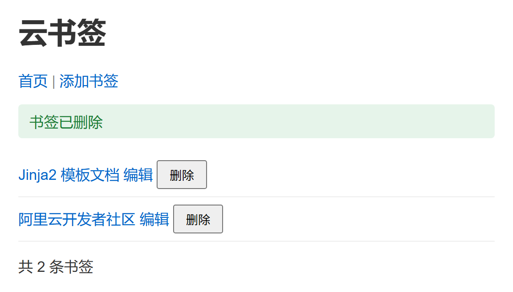
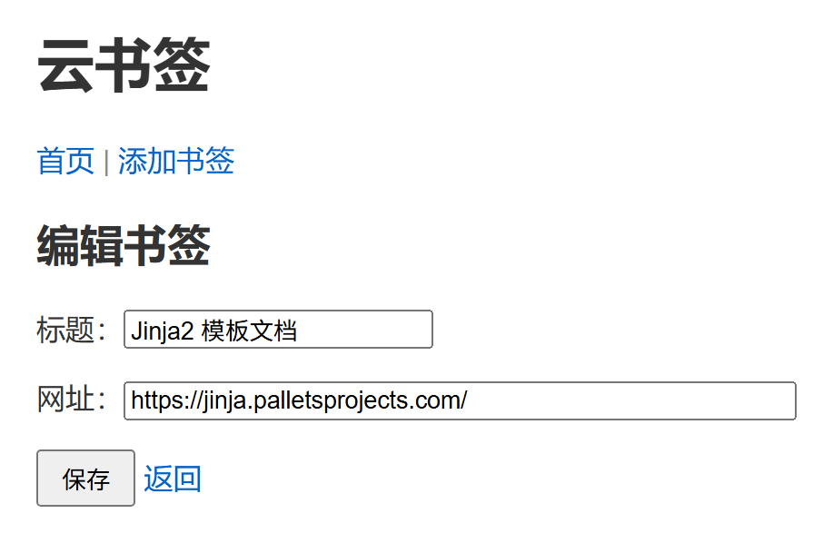

# 第7讲项目讲义　云书签 S4：编辑、删除、排错与测试

> 课程：云应用开发　|　第2章 服务端开发基础　|　第7讲

**本讲目标**：在自己的云书签 S3 上写完编辑与删除；在一份埋了五处故障的云书签上练排错；给云书签写两个自动化测试，把密钥改为从环境变量读取，完成第2章的云书签。

所有命令都在 WSL 的 Ubuntu 终端里执行。遇到报错，先查文末「常见问题」。

---

## 本讲做完的样子

删掉第 1 条之后的首页（左），编辑第 2 条的页面（右）：





每条书签后面的「编辑」「删除」都能用。在终端 2 运行测试，两个都通过：

```
tests/test_bookmarks.py::test_add_bookmark PASSED
tests/test_bookmarks.py::test_reject_bad_url PASSED
```

| 段 | 做什么 | 改哪些文件 | 做完时 |
|---|---|---|---|
| 第一段　编辑与删除 | 按 id 找到书签，写编辑、删除两个视图函数 | 复制 `edit.html`，改 `app.py` | 能编辑、能删除，找不到时提示（检查点 S4a） |
| 第二段　排错闯关 | 在另一份云书签上找出并修好五处故障 | `~/work/排错闯关` 里的文件 | 五关修好，`记录.md` 填满五行 |
| 第三段　测试与收尾 | 写两个测试，密钥改读环境变量，提交 | 新建 `tests/`、`pytest.ini`，改 `app.py`、`requirements.txt` | 两个测试通过，已提交（检查点 S4） |

---

## 本讲弄懂什么

本讲只弄懂一件事：**一次请求在云书签里走过哪几步，出了错怎样知道在哪一步**。下表按一次删除书签的五步排列，最后一行是测试；「模块」一栏对应 PPT 第 5 页知识结构的四个模块，全讲要点见 PPT 第 24 页本讲总结。

| 步 | 模块 | 做什么 | 这一步暴露的错 | 在哪一段看到 |
|---|---|---|---|---|
| ① 发出请求 | 一 | 删除按钮的表单发 `POST /delete/1` | 请求没发出：终端没有记录；方法没放行：405 | 第一段、第二段 |
| ② 找到这一条 | 四 | 路由取出 id，`find_bookmark` 找到书签 | id 不是整数：404；找不到：提示「书签不存在」 | 第一段 |
| ③ 改数据 | 四 | 从列表里删掉，或改字段 | 代码抛异常：500，看调用栈最后一行 | 第二段 |
| ④ 反馈并重定向 | 一 | `flash` 加 302；终端写下这次请求的一行日志 | 没有 302：按 F5 重复提交（第6讲） | 第一段 |
| ⑤ 显示结果 | 四 | 浏览器 `GET /`，模板显示列表和提示 | 模板写错：500，看调用栈最后一行 | 第二段自测 |
| 下排　测试 | 三 | `test_client` 走同样五步，`assert` 检查结果 | 代码改坏：测试失败；漏了 `clear()`：坏代码也通过 | 第三段 |

出了错先问「卡在哪一步」，再到那一步找原因。判断依据是 PPT 第 13 页的故障定位表，第二段的五关一关对应其中一行。

---

## 课前准备

1. 更新课程仓库：`cd ~/cloud-app-dev-2026 && git pull`
2. 列出起始代码：`ls 第2章-服务端开发基础/第07讲-云书签后端、调试排错与自动化测试/起始代码`
   结果：看到 `templates`、`排错闯关`。
3. 列出检查点：`ls cloud-bookmark-检查点`
   结果：看到 `S4a`、`S4` 开头的两个新目录。

   说明：检查点是老师准备的每段完成代码。跟丢时从这里复制，接着做下一段。
4. 进入云书签：`cd ~/work/cloud-bookmark`
5. 查看提交记录：`git log --oneline`
   结果：看到「S3: 添加书签」。做了第6讲拓展的，还有「第6讲拓展」。
6. 查看工作区：`git status`
   结果：显示 `nothing to commit`。
7. 建预测记录：`mkdir -p ~/work/练习 && touch ~/work/练习/第7讲预测.md`

如果第 5 步没有「S3: 添加书签」，执行下面的命令，再照第6讲项目讲义第三段第 3、4 步改 `app.py`，然后提交：

```bash
cp -r ~/cloud-app-dev-2026/cloud-bookmark-检查点/S3-添加书签/templates ~/work/cloud-bookmark/
cp ~/cloud-app-dev-2026/cloud-bookmark-检查点/S3-添加书签/validators.py ~/work/cloud-bookmark/
```

如果第 6 步有未提交的改动，先提交。

---

## 课上开工

在终端 1 执行下面的命令。终端 1 运行服务器，整节课不关。

```bash
cd ~/work/cloud-bookmark
source ../venv/bin/activate
code .
python app.py
```

打开终端 2，执行下面的命令。终端 2 用来执行 `cp`、`curl`、`git` 和测试。

```bash
cd ~/work/cloud-bookmark
source ../venv/bin/activate
```

结果：两个终端的提示符前都有 `(venv)`。

说明：书签存在内存里。服务器每重启一次，列表就恢复成预设的三条；保存 `app.py` 后的自动重启也算（第4章改存数据库）。

---

## 第一段　编辑与删除（模块一）

**目的**：按 URL 里的 id 找到一条书签；编辑沿用添加的取值、验证、回填、重定向；删除只收 POST。原理见教材 2.7.3。

**步骤**：

1. 在终端 2 复制起始代码：

   ```bash
   cp ~/cloud-app-dev-2026/第2章-服务端开发基础/第07讲-云书签后端、调试排错与自动化测试/起始代码/templates/edit.html templates/
   ```

2. 列出模板：`ls templates`
   结果：看到 `add.html`、`base.html`、`edit.html`、`index.html`。
注意：如果 `@app.route('/edit/` 上面还有一行 `# 接口表「打开编辑表单」` 开头的注释，第 3 步从这行注释开始选。

3. 打开 `app.py`，选中从 `@app.route('/edit/<int:bookmark_id>'` 到 `return f'删除书签 {bookmark_id}'` 的几行。
4. 替换为下面的代码，保存：

```python
def find_bookmark(bookmark_id):
    """按 id 找书签，找不到返回 None；编辑、删除都用它"""
    for bm in bookmarks:
        if bm['id'] == bookmark_id:
            return bm
    return None


# 接口表「打开编辑表单」「提交修改」：先找到书签，其余与添加相同
@app.route('/edit/<int:bookmark_id>', methods=['GET', 'POST'])
def edit_bookmark(bookmark_id):
    bookmark = find_bookmark(bookmark_id)
    if bookmark is None:                               # 找不到：提示后回首页
        flash('书签不存在', 'error')
        return redirect(url_for('index'))
    if request.method == 'POST':
        title = request.form.get('title', '').strip()
        url = request.form.get('url', '').strip()

        errors = validate_bookmark(title, url)
        if errors:                                     # 失败：回填用户刚填的，不是原来的
            for e in errors:
                flash(e, 'error')
            return render_template('edit.html', title=title, url=url)

        bookmark['title'] = title                      # 成功：改字段，不追加
        bookmark['url'] = url
        flash('书签更新成功！', 'success')
        return redirect(url_for('index'))
    # GET：表单先填好这条书签的当前值
    return render_template('edit.html', title=bookmark['title'], url=bookmark['url'])


# 接口表「删除」：只收 POST，按钮放在 index.html 的表单里
@app.route('/delete/<int:bookmark_id>', methods=['POST'])
def delete_bookmark(bookmark_id):
    bookmark = find_bookmark(bookmark_id)
    if bookmark is None:
        flash('书签不存在', 'error')
    else:
        bookmarks.remove(bookmark)                     # 删掉找到的那个字典
        flash('书签已删除', 'success')
    return redirect(url_for('index'))
```

说明：两个占位的视图函数换成了真的，上面加了 `find_bookmark`。编辑的 POST 分支与 `add_bookmark` 几乎一样，不同的三处带了注释。

5. 在浏览器打开首页，点第 1 条的「编辑」。
   结果：地址是 `/edit/1`，两个输入框里已经是「Flask 官方文档」和它的网址。
6. 把网址改成 `ftp://x`，点「保存」。
   结果：留在 `/edit/1`，红色提示「网址必须以 http:// 或 https:// 开头」，网址框里还是 `ftp://x`。
7. 标题改成「Flask 文档」，网址改回 `https://flask.palletsprojects.com/`，点「保存」。
   结果：回到首页，绿色「书签更新成功！」，第 1 条的标题是「Flask 文档」，共 3 条。
8. 点第 1 条的「删除」。
   结果：绿色「书签已删除」，共 2 条书签。
9. 看终端 1 最后两行。
   结果：先是 `POST /delete/1` 302，接着是 `GET /` 200。

**预测一　打开已删除的书签**

- **预测**：第 8 步删掉了第 1 条。在浏览器地址栏打开 `http://127.0.0.1:5000/edit/1`，会看到什么？地址栏最后是什么？写进预测记录。
- **运行**：打开这个地址，看页面和地址栏。

<details>
<summary>核对（写完预测再展开）</summary>

回到首页，地址栏是 `/`，顶部红色「书签不存在」，仍是 2 条。

请求在 ② 找到这一条：`/edit/1` 能匹配路由，`find_bookmark(1)` 却返回 `None`。视图函数先 `flash` 再重定向，所以不报错。旧页面上留下的链接、收藏夹里的地址，都会遇到这种情况。

</details>

**检查（检查点 S4a）**：删掉第 1 条后，首页绿色「书签已删除」、共 2 条；再打开 `/edit/1`，回到首页，红色「书签不存在」。

**跟丢了**：在终端 2 执行下面的命令，再照第 3、4 步改 `app.py`。

注意：不要整个复制 `app.py`，否则前几讲的拓展会被覆盖。

```bash
cp ~/cloud-app-dev-2026/cloud-bookmark-检查点/S4a-编辑与删除/templates/edit.html templates/
```

**对照与自测**（举手检查后做，没做完的课后做；教材 2.7.3）

- 第 5 步框里已是原值、第 6 步留着 `ftp://x`，就是 PPT 第 8 页的「预填」与「回填」。
- 第 9 步的 `POST /delete/1` 302，就是 PPT 第 9 页：删除只收 POST，按钮在表单里。
- 预测一回到首页，就是 PPT 第 7 页：找不到就提示并回首页。

<details>
<summary>自测：把第 4 步编辑成功分支里改字段的两行，换成 <code>bookmarks.append({'id': bookmark_id, 'title': title, 'url': url})</code>，把第 2 条的标题改成「Jinja」并保存，首页会怎样？可以动手试，试完改回。</summary>

不报错，也显示「书签更新成功！」。首页变成 4 条：原来的「Jinja2 模板文档」还在，最后多了一条「Jinja」，两条的 id 都是 2。

错在 ③ 改数据：编辑应该改找到的那个字典，这里却追加了一条。到 ⑤ 显示结果时才看出来。

改回那两行，保存。服务器自动重启，列表恢复三条。

</details>

---

## 第二段　排错闯关（模块二）

**目的**：在一份埋了五处故障的云书签上，先按现象判断故障在哪一段，再到那一段找原因、修好。原理见教材 2.8。

**步骤**：

注意：同一时间只能运行一个应用。先停掉自己的云书签，闯关结束再启动。

1. 在终端 1 按 Ctrl+C，停掉云书签。
2. 在终端 2 复制闯关代码：

   ```bash
   cp -r ~/cloud-app-dev-2026/第2章-服务端开发基础/第07讲-云书签后端、调试排错与自动化测试/起始代码/排错闯关 ~/work/
   ```

3. 在终端 1 进入闯关目录：`cd ~/work/排错闯关`
4. 在终端 1 启动闯关应用：`python app.py`
5. 在终端 2 用 VS Code 打开闯关目录：`code ~/work/排错闯关`
6. 在 VS Code 里新建文件 `记录.md`，放在 `app.py` 同一层。
7. 把下面的表头复制进 `记录.md`，保存：

   ```
   | 关 | 我猜在哪一段 | 现象 | 看了哪个现场 | 原因 | 改法 |
   |---|---|---|---|---|---|
   ```

8. 按下表的顺序逐关复现、定位、修好。

| 关 | 用户报告 | 怎样复现 |
|---|---|---|
| 1 | 点导航的「添加书签」，显示 Not Found | 打开首页，点「添加书签」 |
| 2 | 填好了标题，却一直提示「标题不能为空」 | 添加「Python 官方文档」`https://docs.python.org/` |
| 3 | 编辑页点「保存」，什么反应都没有 | 点第 1 条的「编辑」，改标题，点「保存」 |
| 4 | 修好上一关再点「保存」，显示 Method Not Allowed | 同上 |
| 5 | 点任意一条的「删除」，页面出现一大段报错 | 点第 2 条的「删除」 |

说明：每关先在 `记录.md` 写「我猜在哪一段」，再查；修好后把这一行填完。「段」指 PPT 第 13 页故障定位表的五个环节；「现场」指 PPT 第 12 页的终端日志、浏览器错误页、Network 面板。Network 面板用 F12 打开，选「网络」（Network）标签。改了 `.py` 文件，服务器会自动重启；改了模板，刷新浏览器即可。

9. 五关都修好后，在终端 1 按 Ctrl+C，停掉闯关应用。
10. 在终端 1 回到云书签：`cd ~/work/cloud-bookmark`
11. 在终端 1 启动云书签：`python app.py`

**选做　用断点看第 5 关的变量**

第 5 关的调用栈最后一行指出了出错的那一行。想看那一行执行前变量的值，可以用 VS Code 的断点。

1. 在终端 1 按 Ctrl+C，停掉闯关应用。
2. 在 VS Code 里打开闯关目录的 `app.py`，在调用栈指出的那一行的行号左边单击。
   结果：行号左边出现一个红点。
3. 按 F5，在弹出的列表里选「Python 调试程序」，再选「Python 文件」。
   结果：VS Code 下方的终端里显示 `Running on http://127.0.0.1:5000`。
4. 在浏览器点任意一条的「删除」。
   结果：VS Code 停在红点那一行，左侧「变量」里能看到这个函数里每个变量的值。
5. 看完后按 Shift+F5 停止调试，在终端 1 重新执行 `python app.py`。

说明：第 3 步弹出的列表里没有「Python 调试程序」，说明 WSL 里没装 Python 扩展：在 VS Code 左侧「扩展」里搜 Python，点「在 WSL 中安装」。断点不停的，跳过这一项，看调用栈一样能修好第 5 关。

**检查**：

- 闯关应用里添加、编辑、删除都正常：添加有绿色提示；编辑保存后标题改变；删除后条数减一。
- `记录.md` 五行，每行六格都填了。

**跟丢了**：五关没修完的，课后补完。先照第 9—11 步回到自己的云书签，接着做第三段。

**对照与自测**（举手检查后做，没做完的课后做；教材 2.8）

- 每关「看了哪个现场」，对应 PPT 第 12 页的三个现场；第 5 关看的是终端调用栈的最后一行。
- 每关「我猜在哪一段」，对应 PPT 第 13 页故障定位表的一行；五关正好五行。

<details>
<summary>自测：在闯关目录的 <code>templates/index.html</code> 里删掉 <code></code> 这一行，刷新首页，会看到什么？是判断表的哪一行？可以动手试，试完改回。</summary>

500。终端调用栈的最后一行是 `jinja2.exceptions.TemplateSyntaxError`，说遇到了 `endblock`，可它还在等 `endfor`。

这是判断表下方「模板渲染出错」那一行，属于 500 的一种。在 ⑤ 显示结果暴露：路由、视图函数都没错，渲染模板时才出错。

改回 ``，刷新首页，列表恢复正常。

</details>

---

## 第三段　测试与收尾（模块三、四）

**目的**：给云书签写两个自动化测试，亲手改坏一次，看测试报警；把密钥改为从环境变量读取；提交第2章的云书签。原理见 PPT 第 13、14、17 页，教材 2.7.4、课堂实训2-6。

**步骤**：

1. 在终端 2 安装 pytest：`pip install pytest==8.4.2`
2. 在终端 2 把 pytest 加进依赖清单：`echo "pytest==8.4.2" >> requirements.txt`
3. 在终端 2 查看依赖清单：`cat requirements.txt`
   结果：最后一行是 `pytest==8.4.2`。
4. 在 VS Code 里新建文件 `pytest.ini`，与 `app.py` 放在同一层。
5. 把下面的内容复制进 `pytest.ini`，保存：

   ```
   [pytest]
   pythonpath = .
   testpaths = tests
   ```

   说明：`pythonpath = .` 让测试找得到 `app.py`；`testpaths = tests` 让 pytest 只在 `tests/` 里找测试。
6. 在 VS Code 里新建文件夹 `tests`，与 `app.py` 放在同一层。
7. 在 `tests` 里新建文件 `test_bookmarks.py`。
8. 把下面的代码复制进 `tests/test_bookmarks.py`，保存：

```python
# tests/test_bookmarks.py　第7讲第三段：给云书签写的两个测试
import app as bookmark_app


def test_add_bookmark():
    bookmark_app.bookmarks.clear()               # 从干净的状态开始：预设书签里就有「Flask」
    client = bookmark_app.app.test_client()      # 模拟浏览器，不用真的启动服务器
    resp = client.post('/add',
                       data={'title': 'Flask', 'url': 'https://flask.palletsprojects.com'},
                       follow_redirects=True)    # 跟着重定向走到首页
    assert resp.status_code == 200
    assert 'Flask' in resp.get_data(as_text=True)


def test_reject_bad_url():
    bookmark_app.bookmarks.clear()
    client = bookmark_app.app.test_client()
    client.post('/add', data={'title': 'Flask', 'url': 'flask.com'})
    assert len(bookmark_app.bookmarks) == 0      # 不合法的 URL 不应被保存
```

注意：要用 `python -m pytest`，直接执行 `pytest` 可能找不到 `app` 模块。

9. 在终端 2 运行测试：`python -m pytest -v`
   结果：两行 `PASSED`，最后一行 `2 passed`。
10. 打开 `app.py`，选中从 `from flask import` 到 `app.secret_key = 'dev-secret-key'` 那一行。
11. 替换为下面的代码，保存：

```python
import os

from flask import Flask, render_template, request, redirect, url_for, flash
from validators import validate_bookmark

app = Flask(__name__)
# flash 存在会话里，会话要用密钥签名；密钥从环境变量读，代码里只留开发用的默认值
app.secret_key = os.environ.get('SECRET_KEY', 'dev-secret-key')
```

说明：第 1 行导入 `os`；最后一行从环境变量 `SECRET_KEY` 读密钥，没设时用 `'dev-secret-key'`。

12. 在终端 2 带着环境变量读一次密钥：`SECRET_KEY=abc123 python -c "import app; print(app.app.secret_key)"`
    结果：`abc123`。
13. 在终端 2 不带环境变量再读一次：`python -c "import app; print(app.app.secret_key)"`
    结果：`dev-secret-key`。
14. 在终端 2 再运行一次测试：`python -m pytest -v`
    结果：`2 passed`。

**预测二　删掉网址的前缀检查**

- **操作**：打开 `validators.py`，删掉 `elif not url.startswith(` 那一行和它下面的 `errors.append(...)` 一行，保存。
- **预测**：两个测试哪个会失败？失败信息里 `assert` 两边各是什么？写进预测记录。
- **运行**：在终端 2 执行 `python -m pytest -v`。

<details>
<summary>核对（写完预测再展开）</summary>

`test_add_bookmark` 通过，`test_reject_bad_url` 失败，最后一行 `1 failed, 1 passed`。失败信息是 `AssertionError: assert 1 == 0`，下面列出被存进去的 `{'title': 'Flask', 'url': 'flask.com'}`。

错在 ③ 改数据之前少了一道检查，`flask.com` 被存进了列表；页面上不报错，是测试的 `assert` 把它查了出来。这就是「改坏就报警」。

</details>

- **改回**：在终端 2 执行 `git checkout validators.py`，再执行 `python -m pytest -v`，应为 `2 passed`。

15. 在终端 2 查看改动：`git status --short`
    结果：五行：`M app.py`、`M requirements.txt`、`?? pytest.ini`、`?? templates/edit.html`、`?? tests/`。
16. 提交：`git add . && git commit -m "S4: 编辑、删除、测试与配置"`

**检查（检查点 S4）**：

- `python -m pytest -v` 两个测试通过。
- `git log --oneline` 的第一行是「S4: 编辑、删除、测试与配置」。
- 项目结构如下：

```
cloud-bookmark/
├── app.py               编辑、删除；密钥从环境变量读
├── validators.py
├── pytest.ini           本讲新建
├── tests/
│   └── test_bookmarks.py   两个测试
├── templates/
│   ├── base.html
│   ├── index.html
│   ├── add.html
│   └── edit.html        本讲复制
├── static/css/style.css
├── docs/接口表.md
├── requirements.txt     加了 pytest
└── .gitignore
```

**跟丢了**：在终端 2 执行下面的命令，再照第 10、11 步改 `app.py`，然后做第 1、9 步和第 15、16 步。

```bash
cp -r ~/cloud-app-dev-2026/cloud-bookmark-检查点/S4-第2章完成版/tests .
cp ~/cloud-app-dev-2026/cloud-bookmark-检查点/S4-第2章完成版/pytest.ini .
cp ~/cloud-app-dev-2026/cloud-bookmark-检查点/S4-第2章完成版/requirements.txt .
```

**对照与自测**（举手检查后做，没做完的课后做；教材 2.7.4，课堂实训2-6）

- 第 9 步不启动服务器也能测，就是 PPT 第 17 页：test_client 代替浏览器发送请求。
- 预测二的 `assert 1 == 0`，就是 PPT 第 18 页：测试的作用体现在代码被改坏的时候。
- 第 12、13 步读到两个不同的密钥，就是 PPT 第 22 页第二条：密钥从环境变量读取。

<details>
<summary>自测：删掉 <code>test_reject_bad_url</code> 里的 <code>bookmark_app.bookmarks.clear()</code>，代码不改，运行 <code>python -m pytest -v</code>，会怎样？为什么？可以动手试，试完改回。</summary>

`test_reject_bad_url` 失败：`assert 1 == 0`，列表里那一条是 `{'id': 4, 'title': 'Flask', 'url': 'https://flask.palletsprojects.com'}`。代码是对的，测试却失败了。

两个测试共用同一个列表，前一个测试添加的书签留了下来。只运行这一个（`python -m pytest -v -k reject`）则是 `assert 3 == 0`：列表里是预设的三条。所以每个测试第一行都要 `clear()`（PPT 第 18 页的表格）。

改回 `clear()` 这一行，保存。在终端 2 执行 `git status`，结果应为 `nothing to commit`。

</details>

---

## 拓展（课后完成）

**规则**：

- 先提交 S4，再做拓展。本讲是第2章最后一讲，拓展可以改主线的视图函数和模板。
- 每项做完，执行 `python -m pytest -v`，原有的测试必须全部通过。测试失败，说明拓展改坏了主线。
- 可以用 AI。第5周实践课开头抽查，被抽到的人做三件事中的一件：讲清拓展里的一行；当场改坏一处，先预测哪个测试失败再运行；拿一个出错现象说出判断表的哪一行。

**菜单**：

| 编号 | 档 | 任务 | 何时做 | 用到哪一步 |
|---|---|---|---|---|
| E1 | 五级 | 补齐测试：`client` fixture，添加三个、删除两个 | 必做 | 下排测试 |
| E2 | 四级 | 查重：添加、编辑都不许出现重复的网址 | 二选一 | ②、③ |
| E3 | 四级 | 置顶书签：`/pin/<int:id>` 切换置顶，置顶的排在最前 | 二选一 | ①—⑤ |

「用到哪一步」指「本讲弄懂什么」表里的五步和下排。课后作业要写出这一列。

---

**E1　补齐测试**（课堂实训2-6）

- **任务**：在 `tests/test_bookmarks.py` 里写一个名为 `client` 的 fixture：设 `app.config['TESTING'] = True`、清空书签列表，返回 `test_client()`。用它写五个测试：合法添加成功、空标题被拒、网址不以 `http://` 或 `https://` 开头被拒、添加后删除成功、删除不存在的 id 时有「书签不存在」提示。
- **提示**：fixture 用 `@pytest.fixture` 装饰，测试函数的参数写 `client`，pytest 会把 fixture 的返回值传进来。删除要用 `client.post`，不能用 `get`（PPT 第 9 页）。原来的两个测试可以改写成用 fixture 的版本。
- **验证**：`python -m pytest -v` 至少 5 个 `PASSED`；照预测二删掉前缀检查，恰好网址那个测试失败；`git checkout validators.py` 后全部通过。

**E2　查重**

- **任务**：添加时网址已经存在，提示「该网址已经存在」，留在表单并回填，不保存。编辑时网址与**别的**书签重复才拦；不改网址、只改标题，照常保存。
- **提示**：写一个 `url_exists(url, exclude_id=None)`，在列表里找网址相同、且 id 不等于 `exclude_id` 的书签。添加时不传 `exclude_id`，编辑时传当前书签的 id。原理见教材 2.7.3。
- **验证**：添加 `https://flask.palletsprojects.com/`，提示重复，仍是 3 条；编辑第 1 条只改标题，保存成功；把第 2 条的网址改成第 1 条的，提示重复。再加一个测试覆盖其中一种情况。

**E3　置顶书签**（课堂实训2-5）

- **任务**：书签加一个 `pinned` 字段，默认不置顶。新路由 `/pin/<int:bookmark_id>` 只收 POST，把 `pinned` 取反，书签不存在时提示错误，完成后重定向回首页。首页置顶的排在最前、带一个标记；每条书签有一个按钮，文字随状态变为「置顶」或「取消置顶」。
- **提示**：排序用 `sorted(bookmarks, key=...)`，不改列表本身。按钮照删除按钮的写法，放在 `method="post"` 的表单里。想清楚这个路由为什么不收 GET。
- **验证**：置顶第 3 条，它排到最前并带标记；取消置顶后回到原位；`curl -i -X POST http://127.0.0.1:5000/pin/99` 得到 302，首页提示错误，应用不崩溃。

---

## 课后提交

1. 拓展做完后提交：`git add . && git commit -m "第7讲拓展"`
2. 给第2章的完成版打标签：`git tag ch2`
3. 查看标签：`git log --oneline -3`
   结果：第一行后面带 `(tag: ch2)`。
4. 在 4S 交一份文字作业，五部分，按下面的格式：

   ```
   一、git log --oneline -3 的输出
   二、预测记录：粘贴 ~/work/练习/第7讲预测.md（两处，想错的写了原因）
   三、排错闯关：粘贴 ~/work/排错闯关/记录.md
   四、拓展说明：每项一行，写出用到的原理和属于哪一步，如「E2：编辑时排除自身的 id；第 ② 步」
   五、验证：每项的操作与结果（截图或 pytest 输出）
   ```

5. 准备第5周实践课：读教材课后实训2-1「留言板完整后端」。
6. 读教材 3.1：第3章开始学前端。

---

## 常见问题

| 段 | 现象 | 原因 | 处理 |
|---|---|---|---|
| 开工 | `Address already in use` 或 `Port 5000 is in use` | 另一个终端里已经在运行 `python app.py` | 在那个终端按 Ctrl+C，或直接用它。同一时间只运行一个。 |
| 开工 | `No module named 'flask'` | 虚拟环境未激活 | 执行 `source ~/work/venv/bin/activate`。提示符前应出现 `(venv)`。 |
| 一 | `jinja2.exceptions.TemplateNotFound: edit.html` | 第 1 步没做，或 `edit.html` 不在 `templates/` 里 | 重做第一段第 1 步。 |
| 一 | `NameError: name 'find_bookmark' is not defined` | 只替换了两个视图函数，漏了 `find_bookmark` | 照第一段第 4 步的代码补上。 |
| 一 | 点「编辑」仍显示「编辑书签 1 的表单」 | `app.py` 没保存，或替换的位置不对 | 保存后刷新；在 `app.py` 里搜 `编辑书签`，应搜不到。 |
| 一 | 编辑保存后列表多了一条 | 成功分支写成了 `append` | 照第一段第 4 步，改字段：`bookmark['title'] = title`。 |
| 一 | 删掉的书签又回来了 | 保存 `app.py` 后服务器自动重启，列表恢复三条 | 正常现象，数据在内存里（第4章改存数据库）。 |
| 二 | `cd: /home/…/work/排错闯关: No such file or directory` | 第 2 步没做 | 在终端 2 重做第二段第 2 步。 |
| 二 | 改了代码，页面没变化 | 改的是自己的云书签，不是闯关目录 | 看 VS Code 标题栏，应是「排错闯关」。 |
| 二 | 闯关结束后，自己的云书签打不开 | 终端 1 还在运行闯关应用，或还在闯关目录 | 照第二段第 9—11 步回到云书签。 |
| 三 | `ModuleNotFoundError: No module named 'app'` | 没有 `pytest.ini`，或直接执行了 `pytest` | 照第三段第 4、5 步建 `pytest.ini`，用 `python -m pytest`。 |
| 三 | `cat requirements.txt` 的最后一行是 `Werkzeug==…pytest==8.4.2` | 原来的最后一行没有换行，追加的内容接在了它后面 | 在 VS Code 里打开 `requirements.txt`，在 `pytest` 前面按回车，保存。 |
| 三 | `No module named pytest` | 第 1 步没做，或终端 2 的虚拟环境没激活 | 激活虚拟环境，再执行第三段第 1 步。 |
| 三 | `collected 0 items` | 测试文件不在 `tests/` 里，或文件名、函数名不以 `test_` 开头 | 照第三段第 6—8 步检查位置和名字。 |
| 三 | `test_reject_bad_url` 失败，`assert 3 == 0` 或 `assert 1 == 0` | 漏了 `clear()`，或预测二删掉的两行没改回 | 补上 `clear()`；执行 `git checkout validators.py`。 |
| 三 | `NameError: name 'os' is not defined` | 第 11 步的 `import os` 没加 | 照第三段第 11 步的代码改。 |
| 三 | `git status` 里看到 `.pytest_cache` | pytest 的缓存目录 | 一般会自动忽略；看到了就在 `.gitignore` 里加一行 `.pytest_cache/`。 |
| 跟丢了 | 复制检查点后前几讲的拓展没了 | 整个复制了 `app.py` | 执行 `git diff app.py` 找到被删的拓展，复制回去；或执行 `git checkout app.py` 恢复到上次提交，再照步骤手改。 |

---

## 附：云书签的阶段

| 阶段 | 哪一讲 | 做什么 |
|---|---|---|
| S0 | 第3讲 | 接口表 |
| S1 | 第4讲 | 五条路由，返回占位文字 |
| S2 | 第5讲 | 首页换成模板页面 |
| S3 | 第6讲 | 添加书签：表单、重定向与提示、验证 |
| **S4** | **第7讲（本讲）** | **编辑与删除、排错、自动化测试，第2章完成版（tag ch2）** |
