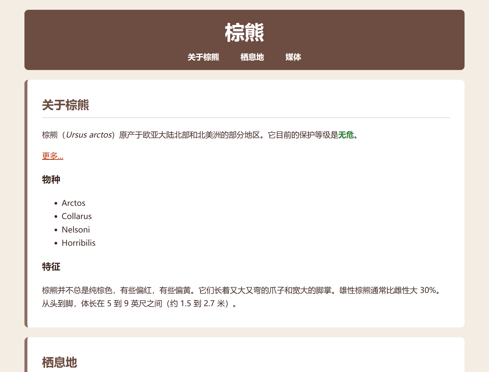
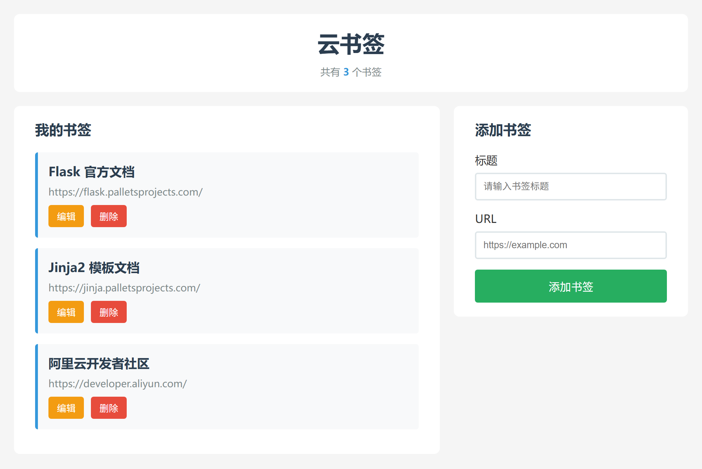
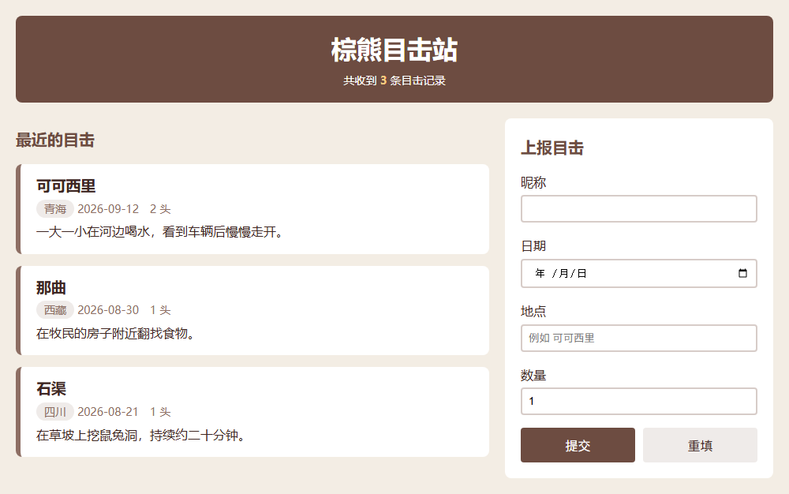

# 第8讲项目讲义　棕熊页学 CSS，云书签 S5b：页面样式

> 课程：云应用开发　|　第3章 前端开发基础　|　第8讲

课上跟着老师做。跟丢时按步骤号找到老师正在做的那一步；差得多，用段末「跟丢了」的命令直接跳到本段终点。

## 做完的样子





| 段 | 步骤 | 做什么 | 做完时 |
|---|---|---|---|
| 第一段　选中与外观 | 1—12 | 给棕熊页接上样式表，改文字和颜色，加导航条 | 有颜色和字体，导航竖排 |
| 第二段　盒子与排列 | 13—17 | 卡片留白与间隔，导航、照片与视频排成一行 | 与第一张图相同 |
| 第三段　云书签的三处 | 18—29 | 给云书签的新前端补两栏、卡片、表单样式 | 与第二张图相同，提交「S5b: 页面样式」 |

## 课前准备

在 WSL 终端执行。第一条 `ls` 应看到 `起始代码`、`检查点`、`CSS速查卡.md`，第二条应看到 `S5a-第三段起点`、`S5b-页面样式`：

```bash
cd ~/cloud-app-dev-2026 && git pull
ls 第3章-前端开发基础/第08讲-CSS样式与页面布局
ls cloud-bookmark-检查点
```

把 `CSS速查卡.md` 看一遍，课上和课后查属性用。

---

## 第一段　选中与外观

**目的**：用选择器选中元素，改文字和颜色（教材 3.2.1—3.2.3）。

1. **取起始代码**。在终端执行：

   ```bash
   mkdir -p ~/work/css-bear && cd ~/work/css-bear
   cp -r ~/cloud-app-dev-2026/第3章-前端开发基础/第08讲-CSS样式与页面布局/起始代码/* .
   code . && explorer.exe .
   ```

   结果：VS Code 和资源管理器都打开 `css-bear`，里面有 `bear.html` 和 `media`。
2. **打开页面**。在资源管理器里双击 `bear.html`。
   结果：浏览器显示没有任何样式的棕熊页。以后每次改完，先保存（Ctrl+S），再刷新（F5）。
3. **新建样式表**。在 VS Code 里新建 `style.css`，与 `bear.html` 同一层。
4. **接上样式表**。在 `bear.html` 的 `<title>棕熊</title>` 下一行加入：

   ```html
       <link rel="stylesheet" href="style.css">
   ```

5. **写第一条规则**。在 `style.css` 里输入：

   ```css
   body {
       color: #3e2723;
       background-color: #f3ede4;
   }
   ```

   结果：页面底色变成米色，文字变成深棕色。
6. **确认样式表被请求**。按 F12，切到 Network，刷新。
   结果：列表里有一行 `style.css`。
7. **加 class 和 id**。在 `bear.html` 里，把三个 `<section>` 的开始标签依次改为：

   ```html
         <section class="card" id="about">
         <section class="card" id="habitat">
         <section class="card" id="media">
   ```

8. **写选择器与颜色**。在 `style.css` 末尾接着输入：

```css
h1, h2 {
    color: #6d4c41;
}

header {
    background-color: #6d4c41;
}

header h1 {
    color: white;
}

.card {
    background-color: white;
}

#media {
    background-color: #efebe9;
}

strong {
    color: #2e7d32;
}
```

   结果：页头深棕底、标题白色；三块内容白底，「媒体」那块浅棕；「无危」变绿。
9. **看 Styles 面板**。在 F12 的 Elements 里点选标题「棕熊」。
   结果：右侧 Styles 里，`h1, h2` 那条的 `color` 被划掉。
10. **写文字样式**。在 `style.css` 末尾接着输入（`body`、`header` 再写一条，浏览器会把两条合起来）：

```css
body {
    font-family: "Microsoft YaHei", Arial, sans-serif;
    line-height: 1.7;
}

header {
    text-align: center;
}

h1 {
    font-size: 40px;
}

a {
    color: #bf360c;
}

a:hover {
    text-decoration: none;
}
```

   结果：字体和行距变了；标题变大、居中；「更多...」变成橙红，鼠标停上去下划线消失。
11. **小练：导航条（自己写）**。
    - 在 `bear.html` 的 `<h1>棕熊</h1>` 下面加三个链接「关于棕熊」「栖息地」「媒体」，分别跳到第 7 步的三个 id。
    - 在 `style.css` 末尾写样式：导航链接白色、加粗、没有下划线。

    结果：页头里有三个白色加粗的链接，上下竖排；点「媒体」，页面跳到媒体那块。参考写法见文末附录。
12. **检查，然后举手**。
    - 页头深棕底，标题白色、居中；下面三个白色导航链接，竖排（链接前的圆点是正常的，第 16 步去掉）。
    - 三块内容白底，「媒体」浅棕；「无危」绿色；「更多...」橙红。

**跟丢了**：执行下面三行，直接到达本段终点（会覆盖你的 `bear.html` 和 `style.css`），然后从第 13 步接着做。

```bash
cd ~/work/css-bear
cp ~/cloud-app-dev-2026/第3章-前端开发基础/第08讲-CSS样式与页面布局/检查点/1-外观版/bear.html .
cp ~/cloud-app-dev-2026/第3章-前端开发基础/第08讲-CSS样式与页面布局/检查点/1-外观版/style.css .
```

---

## 第二段　盒子与排列

**目的**：用盒模型控制留白、间隔和宽度，用 Flex 把一组元素排成一行（教材 3.2.4、3.2.5）。

13. **写盒子的样式**。在 `style.css` 末尾接着输入：

```css
* {
    box-sizing: border-box;
}

body {
    margin: 0;
    padding: 20px;
}

header, main {
    max-width: 900px;
    margin-left: auto;
    margin-right: auto;
}

header {
    padding: 10px;
    margin-bottom: 20px;
    border-radius: 8px;
}

header h1 {
    margin: 0;
}

.card {
    padding: 10px 30px 20px;
    margin-bottom: 20px;
    border-left: 6px solid #8d6e63;
    border-radius: 8px;
}

.card h2 {
    border-bottom: 1px solid #d7ccc8;
    padding-bottom: 6px;
}
```

   结果：页头和三块卡片同宽、整页居中；卡片四角圆、左边一条棕线、文字离边有留白，卡片之间露出米色。
14. **看盒模型图**。在 Elements 里点选「关于棕熊」的 `<section>`，看 Styles 面板底部的盒模型图。
    结果：padding 上 10、左右 30、下 20；border 左 6；margin 下 20。
15. **给两处加类名**。在 `bear.html` 里，把「物种」下面的 `<ul>` 改为 `<ul class="species">`；再把「媒体」里的图片和视频两行用一个 `div` 包起来：

    ```html
            <div class="gallery">
              
              <video src="https://content.codecademy.com/courses/freelance-1/unit-1/lesson-2/htmlcss1-vid_brown-bear.mp4" width="320" controls>你的浏览器不支持播放视频。</video>
            </div>
    ```

16. **写排列的样式**。在 `style.css` 末尾接着输入：

```css
nav ul {
    display: flex;
    justify-content: center;
    gap: 20px;
    list-style: none;
    margin: 0;
    padding: 0;
}

nav a {
    display: block;
    padding: 4px 12px;
    border-radius: 4px;
}

nav a:hover {
    background-color: #8d6e63;
}

.gallery {
    display: flex;
    gap: 20px;
    align-items: flex-start;
}

.gallery img,
.gallery video {
    flex: 1;
    height: auto;
    border-radius: 6px;
}
```

   结果：三个导航链接排成一行、居中，悬停时出现一块浅棕底；照片和视频并排，各占一半宽。
17. **检查，然后举手**。
    - 页头和卡片同宽居中，导航一行，卡片有留白、左边线、间隔。
    - 照片和视频并排。「物种」下面的四项还是竖排，它留给课后的热身练习。

**跟丢了**：执行下面三行，直接到达本段终点（会覆盖你的 `bear.html` 和 `style.css`），然后从第 18 步接着做。

```bash
cd ~/work/css-bear
cp ~/cloud-app-dev-2026/第3章-前端开发基础/第08讲-CSS样式与页面布局/检查点/2-完成版/bear.html .
cp ~/cloud-app-dev-2026/第3章-前端开发基础/第08讲-CSS样式与页面布局/检查点/2-完成版/style.css .
```

---

## 第三段　云书签的三处

**目的**：云书签换一个全新的前端页面 `static/index.html`，用前两段的写法给它补完两栏、卡片、表单三处样式（教材 3.5.2—3.5.4）。

18. **进入云书签**。在终端执行：`cd ~/work/cloud-bookmark`
19. **确认工作区干净**。执行：`git status`
    结果：显示 `nothing to commit`。有未提交的改动先提交。
20. **复制新前端**。执行下面两行。这两个文件是新增的，第2章的 `templates/` 和 `static/css/style.css` 都不动：

    ```bash
    cp ~/cloud-app-dev-2026/cloud-bookmark-检查点/S5a-第三段起点/static/index.html static/
    cp ~/cloud-app-dev-2026/cloud-bookmark-检查点/S5a-第三段起点/static/style.css static/
    ```

21. **提交起点**。执行：`git add . && git commit -m "S5a: 新前端起点"`
22. **打开项目**。执行：`code . && explorer.exe static`
23. **打开页面**。在资源管理器里双击 `index.html`。
    结果：列表和表单上下叠放；三张卡片挤在一起；「标题」和输入框在同一行。
24. **看页面结构**。在 VS Code 里打开 `static/index.html`，对照下表找到各个区域。后面三个小练的选择器都从这张表里取，样式都写在 `static/style.css` 末尾。

    | 页面上的区域 | 元素与类名 |
    |---|---|
    | 主区 | `main`，列表与表单两栏的父元素 |
    | 书签列表一栏 | `section.bookmarks-section` |
    | 每张书签卡片 | `div.bookmark-card` |
    | 添加表单一栏 | `section.form-section` |
    | 每个表单项 | `div.form-group`，里面一个 `label`、一个 `input` |

25. **小练：两栏（自己写）**。
    - 列表和表单左右排开，中间隔 20，列表宽、表单窄（列表 `flex: 2`，表单 `flex: 1`）。
    - 表单不被拉得和列表一样高（写法同第 16 步的 `.gallery`）。
    - 主区宽度不超过 1200，在页面里居中（写法同第 13 步的 `header, main`）。

    结果：两块左右并排，左宽右窄；窗口很宽时两边留白。
26. **小练：卡片（自己写）**。让每张卡片四周留白 15、彼此隔开 15、四角圆 4。
    结果：卡片文字离边有空，卡片之间露出白底。
27. **小练：表单（自己写）**。让「标题」「URL」各占一行，两个输入框占满一行。
    结果：标签在上、输入框在下，输入框与绿色按钮一样宽。
28. **提交**。执行：`git add . && git commit -m "S5b: 页面样式"`
29. **检查，然后举手**。
    - 两栏左宽右窄；卡片有留白和间隔；标签各占一行，输入框占满一行。
    - `git log --oneline -2` 显示 `S5b: 页面样式`、`S5a: 新前端起点`。

三个小练的参考写法见文末附录。第 28 步提交之前样式表改乱了，执行 `git checkout static/style.css` 回到第 21 步提交的起点。

**跟丢了**：执行下面三行，直接到达本段终点（会覆盖 `static/index.html` 和 `static/style.css`），再做第 28 步。复制来的样式表里三处都已写好，课后可以对照附录自己再写一遍。

```bash
cd ~/work/cloud-bookmark
cp ~/cloud-app-dev-2026/cloud-bookmark-检查点/S5b-页面样式/static/index.html static/
cp ~/cloud-app-dev-2026/cloud-bookmark-检查点/S5b-页面样式/static/style.css static/
```

---

## 练习与拓展（课后）

- E1、E2 必做，其余选做。基础档照课上的写法再做一遍，提高档要查速查卡，挑战档只给目标。
- E1—E3 改云书签的 `static/style.css`，只加规则或改值。第12讲从你自己的 S5b 接着写 JavaScript，改样式不影响它。
- 下一次讲前端时抽查：指着自己样式表里的一条规则，说出它选中了谁、为什么生效。

| 编号 | 档 | 要求 | 任务 | 练哪个知识点 |
|---|---|---|---|---|
| 热身 | 基础 | 选做 | 棕熊页：把四个物种排成一行标签 | Flex容器与项目 |
| E1 | 基础 | 必做 | 云书签换一套主题色，改卡片样式 | 颜色属性、盒模型的四层结构 |
| E2 | 提高 | 必做 | 云书签卡片悬停时底色渐变 | 组合选择器与伪类 |
| E3 | 挑战 | 选做 | 云书签窄屏时变成一栏 | Flex常用属性 |
| E4 | 挑战 | 选做 | 棕熊目击站：照目标截图只写样式表 | Flex容器与项目、Flex常用属性 |

**热身　物种标签**

- **任务**：在 `~/work/css-bear/style.css` 里给 `.species` 写样式：四个物种排成一行，之间有间隔，前面没有圆点；每个物种浅棕底（`#efebe9`）、左右留白、圆角。
- **提示**：与第 16 步的导航条是同一种写法，想清楚 `display: flex` 写在 `ul` 上还是 `li` 上。
- **验证**：四个物种成一行，各是一个圆角标签。参考写法见文末附录。

**E1　换一套主题色**

- **任务**：从下表选一套颜色，把云书签 `static/style.css` 里的主色、标题色、卡片底色都换掉；再改卡片样式的两处（如左边线加粗、四角更圆、内边距加大）。

  | 用在哪 | 现在（蓝） | 绿 | 紫 | 橙 |
  |---|---|---|---|---|
  | 主色：书签数、卡片左边线、标题悬停、输入框聚焦边框 | `#3498db` | `#16a085` | `#8e44ad` | `#e67e22` |
  | 标题文字：页头标题、两栏标题、卡片标题 | `#2c3e50` | `#0e6251` | `#4a235a` | `#6e2c00` |
  | 卡片底色 | `#f8f9fa` | `#e8f8f5` | `#f5eef8` | `#fdf2e9` |

- **提示**：在 VS Code 里按 Ctrl+F 查找 `#3498db`，看它出现在哪几条规则里。F12 的 Styles 里点颜色值可以先试改，满意后再写进文件。
- **验证**：书签数、卡片左边线、鼠标停在卡片标题上的颜色、光标点进输入框时的边框，都是新主色。

**E2　卡片悬停过渡**

- **任务**：鼠标停在书签卡片上时，卡片底色在 0.3 秒内慢慢变成白色 `#fff`；移开时慢慢变回。
- **提示**：写一条 `.bookmark-card:hover` 规则改底色；`transition` 的写法见速查卡「本讲不讲的」，想清楚它该写在哪条规则上。
- **验证**：移入、移出时底色都是渐变的，不是一下子变。

**E3　窄屏变一栏**

- **任务**：浏览器窗口窄于 700 时，表单移到列表下面，两块一样宽；窗口变宽时恢复两栏。
- **提示**：用速查卡「本讲不讲的」里的媒体查询，在窄屏时把 `main` 的 `flex-direction` 改成 `column`；再想想 `align-items: flex-start` 在纵向排列时会让两块变成多宽。
- **验证**：窗口拉窄到 700 以下，表单在列表下面，两块左右边对齐；拉宽后恢复左宽右窄。

**E4　棕熊目击站**

- **任务**：把 `作业-棕熊目击站/sightings.html` 复制到 `~/work/sightings/`，HTML 不改，新建 `style.css`，让页面接近目标截图：页头深棕居中；左边三条目击记录是卡片，右边上报表单是白底一块，左右两栏；地区是圆角标签；表单的标签各占一行，输入框占满一行；两个按钮各占一半。

  

- **提示**：两栏写法同第 25 步；按钮各占一半用 `flex`；颜色照抄棕熊页的就行。
- **验证**：窗口拉到约 1000 宽，与目标截图并排对比；左栏明显宽于右栏。

**提交**

1. 在 `~/work/cloud-bookmark` 执行：`git add . && git commit -m "第8讲拓展"`
2. 在 4S 平台提交一个文字作业，按下面的格式：

```
1. git log --oneline -3 的输出（应看到「第8讲拓展」「S5b: 页面样式」）
2. 棕熊页：粘贴 ~/work/css-bear/style.css 的全部内容
3. E1：选了哪套颜色；改了哪几条规则；附一张云书签截图
4. E2：一句话说明 transition 写在 .bookmark-card 上还是 .bookmark-card:hover 上，为什么
5. 选做的 E3、E4：E3 附一张窄屏截图；E4 粘贴 style.css，附截图
```

3. 为下一讲拉取数据库镜像（约 200 MB，在网络好的地方做）：`docker pull mysql:8.0`
   结果：`docker images` 的列表里有 `mysql   8.0`。拉不下来的，下一讲课前找老师拷贝镜像文件。

预习：教材 4.1、4.2（关系型数据库与 ORM）。

---

## 出错了先查这里

| 步骤 | 现象 | 处理 |
|---|---|---|
| 5 | 刷新后没变化 | 没保存；或按 Ctrl+F5 强制刷新 |
| 5 | 整页没有任何样式 | `<link>` 的 `href` 写错，或 `style.css` 不在 `bear.html` 同一层 |
| 8 | 某一条规则没效果 | 类名少了点号或拼错；HTML 里没加 class；F12 的 Styles 里看规则在不在、有没有被划掉 |
| 8、10 | 一条规则之后的规则全部失效 | 前面少了 `}` 或 `;`，从失效的第一条往上找 |
| 11 | 点导航链接不跳转 | `href` 少了 `#`，或与 section 的 id 不一致 |
| 16 | 导航排不成一行 | `display: flex` 写在了 `li` 或 `a` 上，应写在 `nav ul` 上 |
| 16 | 照片和视频没有并排 | 第 15 步没有用 `<div class="gallery">` 包住，或类名不一致 |
| 16 | 视频是黑框 | 视频是外网地址，要联网；不影响本讲 |
| 20 | 找不到 `S5a-第三段起点` | 课程仓库没更新，执行 `cd ~/cloud-app-dev-2026 && git pull` |
| 23 | 页面没有任何样式 | `style.css` 复制到了 `static/css/`，重做第 20 步 |
| 25 | 两块仍上下叠放 | `display: flex` 写在了两个 section 上，应写在父元素 `main` 上 |
| 27 | 输入框超出表单右边 | 样式表开头的 `* { box-sizing: border-box; }` 被删了，补回 |

## 附录：小练参考

**第 11 步　导航条**

`bear.html`，`<h1>棕熊</h1>` 下面：

```html
      <nav>
        <ul>
          <li><a href="#about">关于棕熊</a></li>
          <li><a href="#habitat">栖息地</a></li>
          <li><a href="#media">媒体</a></li>
        </ul>
      </nav>
```

`style.css` 末尾：

```css
nav a {
    color: white;
    font-weight: bold;
    text-decoration: none;
}
```

**第 25 步　两栏**

```css
main {
    display: flex;
    gap: 20px;
    align-items: flex-start;
    max-width: 1200px;
    margin: 0 auto;
}

.bookmarks-section {
    flex: 2;
}

.form-section {
    flex: 1;
}
```

**第 26 步　卡片**

```css
.bookmark-card {
    padding: 15px;
    margin-bottom: 15px;
    border-radius: 4px;
}
```

**第 27 步　表单**

```css
.form-group label {
    display: block;
}

.form-group input {
    width: 100%;
}
```

**热身　物种标签**

```css
.species {
    display: flex;
    gap: 10px;
    list-style: none;
    padding: 0;
}

.species li {
    background-color: #efebe9;
    padding: 2px 14px;
    border-radius: 14px;
}
```
